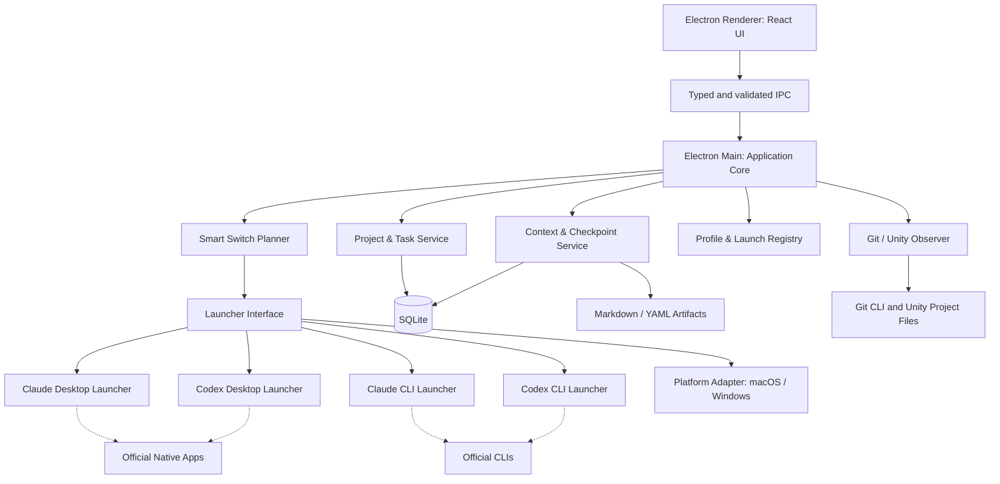

# AgentHub — Technical Design Document (TDD)

> **Project:** AgentHub — Cross-platform AI Agent Workspace & Context Manager  
> **Version:** 0.1.15 (ADR-009, ADR-013–019: terminal, Desktop account instances, Codex profiles, macOS-first, tooling, Git MVP, login, context do agent duy trì; Phase 0 macOS exit review; Phase 1 và 2 trên macOS; FR-018 usage limit; Phase 3 bước 1: mô hình Project)  
> **Updated:** 2026-11-04  
> **Status:** Draft for implementation review  
> **Platforms:** macOS and Windows  
> **Language:** Vietnamese (technical identifiers in English)  
> **Repository location:** `docs/TDD.md`  
> **Source of truth:** This document describes intended behavior, **not** implemented functionality.

---

## 0. Executive summary

AgentHub là desktop application chạy trên **macOS và Windows** để quản lý **Project → Context (tuỳ chọn) → Handoff**, đồng thời hỗ trợ **Claude/Codex Desktop và CLI như các lựa chọn ngang hàng**. Ứng dụng giúp người dùng tạo conversation mới khi chat quá dài, chuyển từ một account/agent sang account/agent khác, hoặc thay đổi Desktop ↔ CLI mà không phải tự viết lại toàn bộ bối cảnh công việc.

**Nhu cầu xuất phát:** Một Unity Developer dùng hai Claude accounts và một Codex account, làm việc trên nhiều Unity projects/Git branches, muốn giảm thời gian đổi công cụ và duy trì context giữa các phiên.

**Thành phần AgentHub sở hữu:**

- Project registry, account **aliases/profile descriptors**, quyền project–account, lịch sử mở.
- Nơi lưu tài liệu context, bộ skill và MCP server để agent đọc, ghi tài liệu (ADR-019); nội dung tài liệu do agent và người dùng viết.
- Quy tắc chọn lời nhắc và cảnh báo khi mở account, launch adapters cho CLI và native Desktop app.
- Cross-platform local persistence, Git observation và kiểm tra Unity project cơ bản.

**Thành phần AgentHub không sở hữu:**

- UI chat, native message history, model inference, agent loop, model billing.
- Đăng nhập bên trong Claude/Codex Desktop, chuyển account Desktop không có API chính thức.
- Toàn bộ nội dung hoặc trạng thái của cuộc hội thoại native khi provider không cung cấp API được hỗ trợ.

**Nguyên tắc sản phẩm:** *Chuyển được công việc, không nhất thiết chuyển được nguyên vẹn cuộc hội thoại.* Desktop và CLI có giá trị ngang nhau về UX, nhưng có **khả năng tích hợp kỹ thuật khác nhau**. Nếu không thể tự động hóa một bước, giao diện phải báo rõ bước thủ công còn thiếu.

### 0.1. Quyết định đã chốt

| Mục | Quyết định |
|---|---|
| Product direction | Hybrid Workspace & Context Manager; không xây lại chat app |
| Supported OS | macOS, Windows (native-first trên Windows; WSL optional). macOS trước; Windows là milestone riêng (ADR-015) |
| Desktop stack | Electron + React + TypeScript |
| Tooling | npm workspaces, electron-vite, electron-builder; versions ở ADR-016 |
| Phạm vi sử dụng | Công cụ cá nhân; Claude Desktop chủ yếu dùng Code tab (§16) |
| CLI terminal | Terminal ngoài; macOS dùng Terminal.app (ADR-009) |
| Storage | SQLite cho metadata; Markdown/YAML cho context artifacts |
| First integrations | Official Claude Code CLI, Codex CLI, native Desktop launcher |
| Context | Tài liệu tuỳ chọn theo project, do agent viết qua skill/MCP, mặc định lưu trong AgentHub; độc lập account/provider (ADR-019) |
| Account handling | Chọn CLI profile; Claude Desktop (ADR-013) và Codex Desktop (ADR-014) có thể mở instance riêng cho mỗi account phụ (opt-in, `conditional`); account trên Desktop và account Codex do người dùng xác nhận |
| Smart Switch | Rules-based, human-in-the-loop; không dùng model API; chọn lời nhắc và cảnh báo khi mở, không còn wizard (ADR-019) |
| Unity/Git | Awareness + safe observation trước; MCP/write automation sau |
| MVP boundary | Không gọi trực tiếp Claude/OpenAI model APIs; không clone chat history |

### 0.2. Thang mức độ cam kết của tích hợp

- **Supported:** Có cơ chế chính thức được tài liệu hóa, nhưng vẫn phải kiểm thử với version trên máy người dùng.
- **Conditional:** Chỉ chạy khi đúng platform, auth mode, provider version hoặc tình trạng session.
- **Manual:** AgentHub chuẩn bị context và mở công cụ; người dùng tự hoàn thành bước trong app gốc.
- **Out of scope:** Không triển khai trong MVP, không ngầm hứa hoạt động.

---

## 1. Product scope & terminology

### 1.1. Định nghĩa

- **Provider:** Claude hoặc Codex.
- **Account profile:** Bản ghi cục bộ về account alias, provider, CLI config root, allowed projects; **không** chứa password/session token.
- **Client mode:** `desktop` hoặc `cli`, được người dùng chọn cho mỗi lần launch.
- **Project:** Thư mục local của Unity project hoặc repository phần mềm khác.
- **Task:** Đơn vị công việc có mục tiêu, tiêu chí hoàn thành, trạng thái và handoff log. Từ ADR-019, task nằm trong tài liệu context, không do AgentHub tạo hay lưu.
- **Conversation/session:** Cuộc hội thoại thuộc native Claude/Codex, thường do chính ứng dụng đó quản lý.
- **Tài liệu context:** Bộ file Markdown theo khuôn §7.2, tuỳ chọn theo project, do agent và người dùng viết.
- **Checkpoint:** Lần agent ghi lại tiến độ vào tài liệu (handoff log, `STATUS`), không phải transcript đầy đủ.
- **Handoff:** Thông tin giúp một session mới tiếp tục: mục handoff log trong task, hoặc bản tóm tắt một lần khi project không bật tài liệu.
- **Chat rời:** Bản tóm tắt của chat không thuộc project nào, chuyển vào project được.
- **Smart Switch:** Bộ quy tắc chọn lời nhắc, cảnh báo và bước thủ công khi mở account (§8).
- **Observed fact:** Thông tin AgentHub tự kiểm tra được (Git status, file path, SHA); khác với nội dung do agent báo cáo.

### 1.2. Vấn đề cần giải quyết

1. Tốn thời gian khi qua lại giữa Claude Account #1, Claude Account #2 và Codex.
2. Khi session quá dài hoặc quota/account trở thành trở ngại, phải tạo chat mới và diễn giải lại công việc.
3. Khó tiếp tục cùng một task trên Claude Desktop, Codex Desktop hoặc CLI.
4. Các native apps có UI và lịch sử chat tốt; làm lại UI là lãng phí.
5. Project/branch/worktree/Unity version dễ bị nhầm khi agent mới nhận task.
6. Những quyết định chỉ còn trong hội thoại cũ dễ mất nếu chưa checkpoint.

### 1.3. Goals

| ID | Goal | Cách đo |
|---|---|---|
| G-01 | Tạo handoff từ task hiện tại sang agent/account bất kỳ | Có artifact và prompt mới xác định nguồn/đích |
| G-02 | Cho phép lựa chọn Desktop hoặc CLI ngang hàng | Hai mode hiện trong cùng launch flow |
| G-03 | Chạy các Claude CLI profiles độc lập | Hai profile có config root khác nhau, chạy song song trên test machine |
| G-04 | Context sống độc lập với Git branch | Đổi branch không làm mất metadata/checkpoint trong AgentHub |
| G-05 | Không giả báo đã đồng bộ native conversation | UI phản ánh đúng mức kiểm soát và độ mới của dữ liệu |
| G-06 | Có ứng dụng cùng tính năng chính trên macOS/Windows | Acceptance tests trên cả hai OS |
| G-07 | Không làm lộ credentials/mã nguồn sang account không được phép | Project–profile allowlist, redaction và confirmation |

### 1.4. Non-goals (MVP)

- Tạo chat client tương đương Claude/Codex Desktop; hiển thị native transcript trong AgentHub.
- OAuth impersonation, tự chuyển account trong Desktop app bằng private endpoints, đọc local DB/Keychain của app khác. (Instance riêng theo ADR-013 và ADR-014 không thuộc nhóm này: chỉ khởi chạy app chính thức và để app hoặc CLI chính thức tự đăng nhập. Ngoại lệ có giới hạn: fallback transcript của ADR-019 chỉ đọc đủ để định vị file session theo folder, không đọc hay hiển thị nội dung, §7.6.)
- Tự động đảo account để vượt quota/rate limits, tự động mua/bán hoặc trung gian thanh toán model usage.
- Gọi trực tiếp Anthropic/OpenAI inference APIs; dùng Claude Agent SDK/Codex App Server để xây chat UI.
- Agent tự ra quyết định thay người dùng về task/branch/security/approval.
- Đồng bộ cloud giữa hai máy, sync native conversation, quản lý nhiều người/team.
- Tự động sửa scene/prefab đang mở trong Unity hay giành quyền điều khiển Unity MCP.
- Tự động merge branch hoặc tự khẳng định QA thành công.

### 1.5. Primary user stories

- **US-01:** Với một task đang làm trên Claude Desktop #1, tôi muốn lưu checkpoint và tiếp tục trên Claude Desktop #2 nếu cần, dù có thể phải chuyển account thủ công trong Desktop.
- **US-02:** Tôi muốn chọn Claude CLI profile #2 từ AgentHub và mở session mới tại đúng project kèm handoff.
- **US-03:** Tôi muốn chuyển Claude → Codex Desktop, nhận prompt/handoff dùng ngay mà không viết lại yêu cầu.
- **US-04:** Chat quá dài; tôi muốn tạo chat mới trên cùng provider/account và đọc checkpoint mới nhất.
- **US-05:** Sau khi đổi Git branch, tôi vẫn xem được task và checkpoint của branch cũ.
- **US-06:** Tôi muốn dùng chung workflow trên Mac và Windows, không phải đổi cách tổ chức tài liệu.
- **US-07:** Nếu checkpoint cũ hoặc chưa đầy đủ, AgentHub phải cảnh báo thay vì tự tuyên bố context hoàn chỉnh.

---

## 2. Functional requirements

### 2.1. MVP requirements (P0)

| ID | Requirement | Acceptance |
|---|---|---|
| FR-001 | Add/edit/remove Project | Chọn thư mục, lưu path, validate tồn tại |
| FR-002 | ~~Add/edit Task per Project~~ Thay bởi ADR-019: hiển thị task đọc từ tài liệu context | Task nằm trong tài liệu, AgentHub không tạo hay sửa |
| FR-003 | Manage provider/account aliases | 2 Claude + 1 Codex profile, thêm profile Codex là tùy chọn (ADR-014); không lưu bí mật |
| FR-004 | Choose Desktop/CLI per launch | Không ép người dùng chọn CLI thay cho Desktop |
| FR-005 | Launch Claude Code CLI with separate config root | Mỗi profile nhận đúng `CLAUDE_CONFIG_DIR` |
| FR-006 | Launch Codex CLI in target project | Đúng cwd/path, binary chính thức |
| FR-007 | Launch Claude/Codex Desktop via supported mechanism | Đúng app; nhận biết khi không thể mở đúng project/session |
| FR-008 | Tài liệu context tuỳ chọn theo project (ADR-019) | Bật/tắt, chọn nơi lưu (mặc định trong AgentHub), khuôn §7.2, "Thêm handoff" ghi atomic |
| FR-009 | Checkpoint do agent ghi | Skill `context-checkpoint` hoặc MCP ghi handoff log; AgentHub thêm Git observation vào cảnh báo |
| FR-010 | Chuyển ngữ cảnh | Có tài liệu: `context-resume`; không tài liệu: bản tóm tắt lưu thành lịch sử handoff; fallback transcript cho chat có folder |
| FR-011 | Quy tắc mở account (§8) | Chọn lời nhắc và cảnh báo; kế hoạch chỉ hiện khi cần quyết định |
| FR-012 | Copy/open context | Copy một dòng hoặc gói ngữ cảnh khi không có MCP; mở tài liệu trong editor |
| FR-017 | Skill và MCP của AgentHub (ADR-019) | Cài skill vào từng account; MCP chỉ đụng thư mục tài liệu và tôn trọng FR-016; hỏi trước khi sửa cấu hình account chính |
| FR-013 | Persist data independently of Git branch | Restart và checkout branch không mất task record |
| FR-014 | Accurate status/provenance | Không ghi `synced`, `completed` nếu chỉ mở Desktop |
| FR-015 | macOS + Windows builds | Mỗi OS chạy được smoke tests và launch adapters |
| FR-016 | Project/profile access control | Cảnh báo và chặn profile không được phép |
| FR-018 | Hiển thị usage limit của từng account (SPIKE-16) | Phần trăm đã dùng và giờ đặt lại của cửa sổ 5 giờ và tuần, lấy từ CLI chính thức của account (Claude `/usage`, Codex app-server); không đọc được thì ghi rõ lý do, không hiện 0%; chỉ giữ trong bộ nhớ; không tự đổi account khi chạm hạn mức |

### 2.2. Follow-up requirements (P1)

- FR-101: Git status đầy đủ, changed file names, diff summaries. Branch, HEAD SHA và dirty/clean thuộc MVP ([ADR-017](decisions/017-mvp-git-observations.md)).
- FR-102: Worktree registry; chỉ hỗ trợ tạo/mở worktree sau khi safety checks.
- FR-103: Tự xác định Unity version và phân biệt Editor instance/worktree.
- FR-104: Shortcut/hotkey, recent tasks, search trong context artifacts.
- FR-105: CLI process status/return code; optional embedded terminal (không phải chat UI).
- FR-106: Tùy chọn explicit task checkpoint reminder, chỉ khi người dùng bật.
- FR-107: Import/export task contexts qua Git; xử lý conflicts bằng review.

### 2.3. Future requirements (P2, chưa cam kết)

- Official session deep links nếu provider công bố giao thức đủ ổn định.
- Read-only MCP/Unity state verification; write ownership chỉ sau safety design.
- Multi-device context synchronization với opt-in encryption.
- Optional SDK integrations nếu mang lại giá trị thực và đáp ứng licensing/auth policies.

### 2.4. Non-functional requirements

| ID | Requirement | Target/behavior |
|---|---|---|
| NFR-001 | Local-first | Không cần AgentHub cloud backend |
| NFR-002 | Data durability | SQLite transaction; temp+rename cho Markdown |
| NFR-003 | Startup behavior | Không đợi provider đăng nhập hoặc model phản hồi mới mở UI |
| NFR-004 | Security | Không lưu password/tokens; không in secrets vào logs |
| NFR-005 | Cross-platform | OS-specific code chỉ nằm trong PlatformAdapter/Launcher |
| NFR-006 | Observability | Structured local logs, mức log có thể cấu hình |
| NFR-007 | Maintainability | TypeScript strict, unit/integration/e2e checks |
| NFR-008 | Accessibility | Keyboard navigation, focus states, readable errors |
| NFR-009 | Privacy | No telemetry mặc định; explicit opt-in nếu thêm sau |
| NFR-010 | Upgrade | Versioned migrations + backups; không âm thầm ghi đè data |

---

## 3. Integration feasibility and policy boundaries

> **Thời điểm tham chiếu:** 2026-10-29. Provider CLIs/apps có thể thay đổi nhanh. Phải kiểm thử với bản cài thực tế và kiểm tra lại điều khoản trước khi phân phối ứng dụng cho người khác. Mục này không phải tư vấn pháp lý.

### 3.1. Capability matrix

| Target | Launch | Set account | Inject context | Get full history | Remarks |
|---|---|---|---|---|---|
| Claude CLI | Supported | Conditional via separate supported config dirs | Prompt/file, verified flags | Không cần cho MVP | User tự đăng nhập từng profile |
| Claude Desktop (Code) | Supported | Conditional via account instance (ADR-013); Manual khi không đạt | `CLAUDE.md` + user prompt; native resume conditional | Không hứa có API đồng bộ | Phân biệt Code tab với Claude Chat thường |
| Codex CLI | Supported | Conditional via `CODEX_HOME` (ADR-014) | Prompt/file instructions | Không cần cho MVP | `AGENTS.md` cho repo instruction |
| Codex Desktop | Supported | Conditional via instance (ADR-014); Manual khi không đạt | Workspace + context file/prompt | Không hứa có API đồng bộ | Workspace open behavior khác giữa OS |

Bảng này là thiết kế. Mức đã kiểm chứng theo OS và version nằm trong [feasibility.md](feasibility.md#capability-matrix-thực-tế).

**Không đồng nhất các khái niệm:** `open app`, `open workspace`, `resume native session`, `switch account`, `inject prompt`, `sync conversation` là những capabilities độc lập. Launcher chỉ quảng bá capability nào đã được xác nhận.

### 3.2. Claude integration

- Claude Code hỗ trợ `CLAUDE_CONFIG_DIR` để đặt vị trí lưu cấu hình, credentials và session history; phù hợp tạo hai CLI profile độc lập. Sử dụng **absolute path** và đặt env riêng cho từng process.
- `CLAUDE.md`/`CLAUDE.local.md` tại project được sử dụng bởi Claude Code CLI và Claude Desktop Code session, theo tài liệu. **Không** suy rộng sang toàn bộ Claude Chat UI hoặc mọi chế độ remote.
- Lệnh `claude --desktop` và `claude --desktop --resume <session-id>` tồn tại ở các bản hỗ trợ; yêu cầu platform/auth/version/session state cụ thể. Theo tài liệu tra cứu: macOS và Windows x64, Claude subscription; không hỗ trợ API-key auth hoặc WSL cho luồng chuyển session cục bộ này.
- Nếu Claude Desktop đang đăng nhập account khác profile CLI, không được tự tuyên bố đã chuyển đúng account; yêu cầu user confirmation.
- Không sửa binary Claude Code, không trích xuất credentials, không làm trung gian billing. Khi phân phối product có khả năng chạy Claude Code, cần rà soát điều khoản Anthropic áp dụng cho bên thứ ba.

**CLI example — macOS** (minh họa, paths thực tế do người dùng thiết lập):

```bash
CLAUDE_CONFIG_DIR="$HOME/.agenthub/claude-a" claude
CLAUDE_CONFIG_DIR="$HOME/.agenthub/claude-b" claude
```

**CLI example — Windows PowerShell** (minh họa):

```powershell
$env:CLAUDE_CONFIG_DIR = "$HOME\.agenthub\claude-a"
claude
# Mở một PowerShell process khác với profile b; không đặt lại env giữa session đang chạy.
```

Khi triển khai Electron, **không** ghép shell command từ input; truyền `cwd` + `env` vào process launcher bằng argument array.

### 3.3. Codex integration

- Codex CLI được mở trong directory của project; instructions ổn định dùng `AGENTS.md`.
- Theo tài liệu chính thức, `codex app PATH` mở ứng dụng/workspace trên macOS; ở Windows, hành vi có thể chỉ mở app và in đường dẫn để người dùng mở. Không coi đây là native thread handoff.
- **Nhiều profile Codex là tùy chọn trong MVP** ([ADR-014](decisions/014-codex-profiles.md)): mỗi profile có `CODEX_HOME` riêng; profile phụ mở Codex Desktop bằng instance riêng. Mặc định vẫn là một profile `~/.codex`. (Sửa đổi 2026-10-30; bản trước chỉ yêu cầu một profile Codex.)
- Account Codex chỉ do người dùng xác nhận qua `/status`, vì `codex login status` không báo account. Khi instance riêng không đạt, người dùng tự sign in trong app gốc (ADR-006).
- Config isolation/CLI auth của Codex phải kiểm thử theo phiên bản cụ thể; CLI có thể tự cập nhật.
- Không dùng internal Desktop DB, private endpoints hay credential files để suy ra session/account.

### 3.4. CLI vs Desktop parity

**Parity về sản phẩm:** UI luôn cho chọn Desktop và CLI. **Không parity về tự động hóa:** CLI thường điều khiển được cwd/env/prompt; Desktop có thể chỉ mở app và yêu cầu người dùng tạo chat/dán prompt. AgentHub phải gắn nhãn `automatic`, `conditional`, `manual` vào từng bước.

### 3.5. Feasibility gates cần làm trước UI lớn

| ID | Spike | Pass criteria |
|---|---|---|
| SPIKE-01 | Claude CLI profile A/B (macOS, Windows) | Hai profile độc lập chạy song song, auth riêng, không lẫn data |
| SPIKE-02 | Claude Desktop launcher | Mở được Code workspace; xác minh điều kiện `--desktop` / `--resume` |
| SPIKE-03 | Codex Desktop launcher | Hành vi thực tế được ghi trên cả macOS/Windows |
| SPIKE-04 | Context instructions recognition | Claude Code đọc `CLAUDE.md`; Codex đọc `AGENTS.md` từ đúng project |
| SPIKE-05 | Account mapping | Không có tuyên bố sai về account native Desktop hiện tại |
| SPIKE-06 | Legal/policy review | Documented integration paths, phân biệt personal-only và phân phối |
| SPIKE-07 | Claude Desktop account instance (bổ sung trong Phase 0) | Instance riêng giữ account khác song song với instance mặc định; Code tab dùng đúng account và config root |
| SPIKE-08 | Codex profile isolation qua `CODEX_HOME` (bổ sung trong Phase 0) | Hai account tách nhau ở CLI và Desktop; đăng nhập profile mới không đổi profile cũ |
| SPIKE-09 | Launcher prototype trên Electron (bổ sung trong Phase 0) | Các launch đã chốt chạy được từ app mở bằng Finder, với env allowlist |
| SPIKE-10 | MCP server chạy từ `.app` (ADR-019 điều kiện 4) | Client MCP khởi chạy server bằng binary của app, không cần Node riêng, khi app không mở |
| SPIKE-11 | MCP trên Codex (ADR-019 điều kiện 1) | MCP server ghi được thư mục tài liệu ngoài workspace; biết cách Codex phê duyệt tool đọc và tool ghi |
| SPIKE-12 | MCP trên Claude Desktop (ADR-019 điều kiện 2, 3) | Tab Code và Chat của instance phụ gọi được tool của server đăng ký cho account đó |
| SPIKE-13 | Prompt ban đầu và `--add-dir` (ADR-019 điều kiện 5) | Hai CLI nhận nguyên văn lời nhắc khi mở tương tác; `--add-dir` cho ghi thư mục ngoài workspace |
| SPIKE-14 | Thư mục skill theo account và project (ADR-019 điều kiện 6) | Mỗi provider có thư mục skill theo account mà account khác không đọc; biết thư mục cấp project và thư mục dùng chung |
| SPIKE-15 | Định vị session gần nhất theo folder (ADR-019 điều kiện 7) | Tìm đúng session gần nhất của folder chỉ từ metadata; agent provider kia đọc được phần cuối file |

**Fallback:** Nếu một launcher không xác minh được session/account, AgentHub vẫn hỗ trợ `Open app` + `Open folder` + `Copy Handoff Prompt`; không chặn toàn bộ workflow.

---

## 4. Architecture overview

### 4.1. Component diagram



**Main Process** chịu trách nhiệm mọi thao tác FS/process/OS; **Renderer** chỉ xem dữ liệu và gọi IPC đã validate. Native apps giữ nguyên nhiệm vụ chat/model/review.

### 4.2. Proposed layers

1. **Presentation:** Project list, Task detail, Context Editor, Smart Switch wizard, Launch history, Settings.
2. **Application services:** Orchestrate task/checkpoint/handoff, validate permissions and capabilities.
3. **Domain:** `Project`, `Task`, `AccountProfile`, `Checkpoint`, `Handoff`, `LaunchAttempt`, value objects và domain rules.
4. **Infrastructure:** SQLite, atomic filesystem writer, Git CLI, process launcher, OS-specific implementation.
5. **Integrations:** Official Claude/Codex CLI binaries và native Desktop launchers; không bao gồm model SDK trong MVP.

### 4.3. Folder/repository structure (agreed)

```text
agent-hub/
├── README.md
├── AGENTS.md                     # Shared agent entrypoint (Codex reads directly)
├── CLAUDE.md                     # Claude entrypoint; imports AGENTS.md
├── .gitattributes                # Line endings for macOS/Windows
├── .gitignore
├── docs/
│   ├── README.md                 # Documentation map
│   ├── TDD.md
│   ├── ROADMAP.md                # Milestones and exit criteria
│   ├── STATUS.md                 # Verified current state
│   ├── DEVELOPMENT.md            # Shared development rules
│   ├── feasibility.md            # Phase 0 plan and evidence
│   └── decisions/               # Architecture Decision Records
├── apps/
│   └── desktop/
│       ├── src/
│       │   ├── main/            # Electron main, IPC, OS/process access
│       │   ├── preload/         # Safe, narrow contextBridge APIs
│       │   └── renderer/        # React components
│       └── tests/
├── packages/
│   ├── domain/                   # Entities, value objects, business rules
│   ├── application/              # Use cases, ports, orchestration
│   ├── contracts/                # IPC DTOs, events, validation schemas
│   ├── persistence/              # SQLite + file store
│   ├── integrations/             # Launcher adapters
│   └── platform/                 # Darwin/Win32 adapters, read-only Git/Unity observers
├── scripts/
└── spikes/                       # Isolated feasibility experiments
    └── <spike-name>/
        ├── evidence/             # Sanitized evidence, committed
        └── local/                # Raw local output, ignored
```

Cấu trúc monorepo với các package boundaries trên đã được người dùng chốt ngày 2026-10-29; xem [ADR-012](decisions/012-initial-package-boundaries.md). Package directories được tạo ngay trong repository foundation. Workspace manifests, package manager, build tool và dependency versions được chốt ở [ADR-016](decisions/016-workspace-and-build-tooling.md); cây trên chỉ liệt kê thư mục và tài liệu, không liệt kê file cấu hình ở root.

`application` phụ thuộc `domain` và định nghĩa các port cho persistence, launcher và platform. Các package hạ tầng triển khai port; Electron Main khởi tạo và kết nối implementation. `integrations` nhận platform port qua dependency injection. `contracts` chứa hợp đồng truyền dữ liệu độc lập với Electron/Node và domain implementation; Renderer/Preload chỉ dùng hợp đồng cùng API được expose. Quy tắc chi tiết ở [DEVELOPMENT.md](DEVELOPMENT.md).

Tài liệu hiện dùng tiếng Việt, giữ tên file và thuật ngữ kỹ thuật bằng tiếng Anh. Khi chuyển sang tiếng Anh, giữ đường dẫn tài liệu ổn định. SQLite và artifacts do ứng dụng sinh ra vẫn nằm ngoài repository theo §6; tài liệu phát triển trong `docs/` không phải runtime artifact store.

### 4.4. Main interfaces (illustrative TypeScript)

```ts
type Provider = 'claude' | 'codex';
type ClientMode = 'desktop' | 'cli';
type SupportLevel = 'supported' | 'conditional' | 'manual' | 'unsupported';

type LauncherCapabilities = {
  openApp: SupportLevel;
  openWorkspace: SupportLevel;
  selectAccount: SupportLevel;
  resumeNativeSession: SupportLevel;
  injectContext: SupportLevel;
};

type LaunchRequest = {
  projectId: string;
  taskId: string;
  provider: Provider;
  profileId: string;
  mode: ClientMode;
  contextSnapshotId?: string;
  nativeSessionId?: string;  // optional; only use if provider supports it
};

type PlannedStep = {
  label: string;
  execution: 'automatic' | 'conditional' | 'manual';
  warning?: string;
};

type LaunchPlan = {
  request: LaunchRequest;
  steps: PlannedStep[];
  requiredConfirmations: string[];
  capabilityVersion: string;
};

interface Launcher {
  getCapabilities(): Promise<LauncherCapabilities>;
  plan(request: LaunchRequest): Promise<LaunchPlan>;
  launch(plan: LaunchPlan): Promise<LaunchResult>;
}
```

`plan()` không được gọi model API. `launch()` không tự động trả về `sessionReady` nếu chỉ gọi OS để mở native app. `LaunchResult` phải phân biệt `appOpened`, `workspaceOpened`, `sessionStarted` và `userActionRequired`.

### 4.5. Typed IPC (proposal)

| Channel | Direction | Data |
|---|---|---|
| `projects:list` | Renderer → Main | Search/filter |
| `projects:add` | Renderer → Main | Validated path |
| `context:settings` | Renderer → Main | Project ID + bật/tắt + nơi lưu |
| `context:overview` | Renderer → Main | Project ID → task, handoff gần nhất, cảnh báo (đọc từ tài liệu) |
| `context:appendHandoff` | Renderer → Main | Project ID + task + text + expected checksum |
| `skills:install` | Renderer → Main | Account ID + phạm vi |
| `launch:plan` | Renderer → Main | LaunchRequest |
| `launch:execute` | Renderer → Main | Plan ID + confirmations |
| `launch:status` | Main → Renderer | Verified launch states |

Preload expose **chỉ** những methods đã định nghĩa; không expose `ipcRenderer`, `child_process` hoặc filesystem trực tiếp cho React UI.

---

## 5. Cross-platform design

### 5.1. Runtime responsibilities

| Concern | macOS adapter | Windows adapter |
|---|---|---|
| App data | `~/Library/Application Support/AgentHub/` | `%APPDATA%\AgentHub\` (theo Electron `app.getPath('userData')`) |
| Open native app | Official CLI hoặc OS open mechanism | Official CLI hoặc OS open mechanism |
| Terminal | Terminal.app ([ADR-009](decisions/009-external-terminal.md)); terminal khác chưa có evidence | Windows Terminal / PowerShell if configured |
| Process args | `spawn(executable, args, { cwd, env })` | Tương tự; xử lý `.cmd`, `PATHEXT` qua safe resolution |
| Paths | POSIX paths | Win32 paths / case-insensitive / drive letters |
| Credentials | Provider quản lý; AgentHub không đọc | Provider quản lý; AgentHub không đọc |
| WSL | Not applicable | Optional explicit user-configured execution target |
| Packaging | Code signing / notarization (for distribution) | Code signing / installer (for distribution) |

**Path policy:** Persist absolute OS-specific project paths theo từng installation, không chép trực tiếp Mac path sang Windows. Dùng `projectId` ổn định + per-device path mapping khi thêm Git sync sau này.

### 5.2. Process launching safety

- Resolve executable từ cấu hình hoặc PATH; kiểm tra tồn tại và hiển thị resolved path cho người dùng.
- Không dùng `exec('claude ... ' + userInput)`; ưu tiên argument arrays và `shell: false` khi khả thi.
- Đưa profile qua environment của **child process**, không thay toàn bộ user environment.
- Trên Windows, test cách mở CLI `.exe`/`.cmd` qua launch target được hỗ trợ; không giả định POSIX PTY có trên Windows.
- Cho phép `cwd` chỉ trong project đã đăng ký hoặc worktree được người dùng chọn.
- Không tự đóng native Desktop app khi người dùng đóng AgentHub.
- Không tự kill terminal/CLI process đã detach (ADR-009).
- Capture launch exit code/stderr giới hạn, redact credentials và paths nhạy cảm trong diagnostic logs.

**Điều kiện trên macOS từ [SPIKE-09](../spikes/09-electron-launcher-prototype/evidence/2026-11-01-macos.md):**

- Dựng env của child process từ allowlist, kể cả khi gọi `open`, vì `open` chuyển env của process gọi sang app được mở. Môi trường GUI không có `LANG`, nên launcher tự đặt.
- App mở từ Finder không thấy CLI cài qua nvm trên `PATH`, và `zsh -lc` cũng không thấy. Dùng `zsh -ilc`, có timeout, với dự phòng quét thư mục; thêm thư mục của executable vào `PATH` của child process.
- `claude --desktop` từ chối pipe; chạy qua pty (`/usr/bin/script` đủ dùng). Kiểm tra `claude auth status` trước và sau khi chạy, và báo rõ nếu login bị mất; chỉ báo "đã gửi lệnh mở", không dựa vào exit code.
- Mở CLI tương tác bằng file `.command` dùng một lần trong thư mục tạm riêng, giá trị được quote đầy đủ và dùng `env -i`. Cách này cho PID và exit status, không có handle của cửa sổ Terminal (ADR-009).
- CLI có thể để lại process nền (daemon của Codex); exit status không có nghĩa là profile đã hết process.
- Trên macOS, `open -b`, link và lệnh dựa trên chúng (`claude --desktop`, `codex app`) đi tới instance khởi động sớm nhất của app. Khi đó không dùng các lệnh này để mở app chính; không gọi `open -n` lên một thư mục dữ liệu đang chạy, vì Claude sinh process trùng ([evidence](../spikes/07-desktop-account-switch/evidence/2026-11-02-macos-instance-routing.md)).

### 5.3. Windows-native vs WSL

Windows-native CLI là default nếu tương thích với version đã cài. WSL là **optional explicit mode**, vì `C:\Project` và `/mnt/c/Project` có semantics khác, và Unity Editor thường chạy trên Windows host. Nếu hỗ trợ WSL sau MVP, adapter phải map path, cwd, binary và auth profile một cách riêng biệt; không tự chuyển đổi ngầm.

### 5.4. OS test matrix

- macOS Apple Silicon, latest supported OS phiên bản dự án đã quyết định.
- Windows 11 x64; làm rõ yêu cầu Windows 10 qua ADR nếu cần.
- Claude Code install/version khác nhau; Codex install/version khác nhau.
- Có/không cài Desktop app, có/không cài CLI.
- Git repo dirty/clean, path có khoảng trắng và Unicode, thư mục không có quyền ghi.
- Auth valid/expired/unknown — không đọc credentials để quyết định.

---

## 6. Local storage & data model

### 6.1. Storage strategy

- **SQLite:** Project, cài đặt tài liệu của project, Profile descriptors, quyền project–account, Launch history, per-device settings. Không lưu task, checkpoint hay handoff index (ADR-019).
- **Artifact store:** Markdown/YAML được tạo và có thể mở ngoài ứng dụng; dùng UUID paths hoặc deterministic task IDs.
- **Git repo:** Không phải primary database của app. Chỉ export những docs được chọn và an toàn để commit.
- **Secrets:** AgentHub không lưu subscription credentials; nếu về sau có secret cấu hình riêng, bắt buộc dùng native secure storage và thiết kế lại threat model.

### 6.2. Proposed SQLite schema (draft)

```sql
CREATE TABLE projects (
  id TEXT PRIMARY KEY,
  name TEXT NOT NULL,
  created_at TEXT NOT NULL,
  updated_at TEXT NOT NULL
);

CREATE TABLE project_locations (
  id TEXT PRIMARY KEY,
  project_id TEXT NOT NULL REFERENCES projects(id),
  device_id TEXT NOT NULL,
  absolute_path TEXT NOT NULL,
  UNIQUE(project_id, device_id)
);

CREATE TABLE tasks (
  id TEXT PRIMARY KEY,
  project_id TEXT NOT NULL REFERENCES projects(id),
  title TEXT NOT NULL,
  objective TEXT NOT NULL,
  acceptance_criteria TEXT NOT NULL DEFAULT '',
  status TEXT NOT NULL CHECK(status IN
    ('backlog','active','blocked','in_review','done','archived')),
  created_at TEXT NOT NULL,
  updated_at TEXT NOT NULL
);

CREATE TABLE account_profiles (
  id TEXT PRIMARY KEY,
  provider TEXT NOT NULL CHECK(provider IN ('claude','codex')),
  alias TEXT NOT NULL,
  cli_config_root TEXT,
  enabled INTEGER NOT NULL DEFAULT 1,
  created_at TEXT NOT NULL
);

CREATE TABLE project_profile_permissions (
  project_id TEXT NOT NULL REFERENCES projects(id),
  profile_id TEXT NOT NULL REFERENCES account_profiles(id),
  allowed INTEGER NOT NULL,
  PRIMARY KEY(project_id, profile_id)
);

CREATE TABLE checkpoints (
  id TEXT PRIMARY KEY,
  task_id TEXT NOT NULL REFERENCES tasks(id),
  artifact_path TEXT NOT NULL,
  source_type TEXT NOT NULL,       -- manual | agent_supplied | git_observed
  git_sha TEXT,
  revision INTEGER NOT NULL,
  created_at TEXT NOT NULL
);

CREATE TABLE handoffs (
  id TEXT PRIMARY KEY,
  task_id TEXT NOT NULL REFERENCES tasks(id),
  checkpoint_id TEXT REFERENCES checkpoints(id),
  source_profile_id TEXT REFERENCES account_profiles(id),
  target_profile_id TEXT REFERENCES account_profiles(id),
  target_mode TEXT NOT NULL CHECK(target_mode IN ('desktop','cli')),
  artifact_path TEXT NOT NULL,
  created_at TEXT NOT NULL
);

CREATE TABLE launch_attempts (
  id TEXT PRIMARY KEY,
  task_id TEXT NOT NULL REFERENCES tasks(id),
  profile_id TEXT NOT NULL REFERENCES account_profiles(id),
  mode TEXT NOT NULL CHECK(mode IN ('desktop','cli')),
  status TEXT NOT NULL,            -- planned | launched | manual_step | failed
  external_session_ref TEXT,       -- nullable, only verified native ref
  error_code TEXT,
  created_at TEXT NOT NULL
);
```

**Implementation rules:** timestamps UTC ISO-8601; IDs UUID; indexes trên `tasks(project_id)`, `checkpoints(task_id, created_at)` và `launch_attempts(task_id, created_at)`; foreign keys enabled; versioned migrations. Không suy ra profile đăng nhập Desktop từ field `profile_id`.

**Đã triển khai (Phase 1):** `projects`, `project_locations`, `tasks` ở migration 1. Khác với draft: `projects` có thêm `removed_at`, vì gỡ project chỉ ẩn nó, không xoá task và artifact (§6.4); thêm bảng `settings(key, value)` cho per-device settings (§6.1). Migration 2 thêm `account_profiles`, `project_profile_permissions`, `launch_attempts`. Khác với draft: `account_profiles` có thêm `desktop_data_dir` (ADR-013, ADR-014); `launch_attempts` có thêm `outcome` (JSON) và `account_confirmed_at` (chỉ ghi khi người dùng xác nhận), chưa có `external_session_ref` vì chưa có native ref nào đã xác minh, và status `planned` được ghi trước khi launch. Migration 3 thêm `account_profiles.account_email` và bỏ các alias do AgentHub tự đặt (ADR-018).

**Phase 3 (ADR-019):** không thêm `checkpoints`, `handoffs` như draft. **Đã triển khai ở migration 4 (2026-11-05):** bỏ bảng `tasks` (backup tự động trước khi nâng schema); `launch_attempts` tạo lại với `project_id` thay `task_id`, thêm `task_ref` (đường dẫn task trong tài liệu, nullable, chưa dùng), giữ các lần mở cũ qua project của task; `projects` thêm `context_enabled` (mặc định 0) và `context_language` (`en` hoặc `vi`, mặc định `en`); `project_locations` thêm `context_path`, vì folder tài liệu tự chọn là đường dẫn trên từng máy, null nghĩa là thư mục mặc định (§6.3). Index `launch_attempts(project_id, created_at)`.

### 6.3. Local artifact layout

Theo ADR-019 (thay layout theo task của bản trước):

```text
<AgentHub userData>/
├── agenthub.sqlite
├── backups/
├── projects/
│   └── <project-id>/
│       ├── context/       # Tài liệu context khi lưu trong AgentHub (khuôn §7.2)
│       └── handoffs/      # Bản tóm tắt chuyển ngữ cảnh khi project không bật tài liệu
├── loose-chats/           # "Chat rời" không thuộc project nào
└── logs/
```

Khi người dùng chọn nơi lưu tài liệu khác, `context/` nằm ở đường dẫn đó; AgentHub chỉ lưu đường dẫn. Artifact theo task của Phase 1 (`artifacts/<project-id>/<task-id>/`) chỉ có dữ liệu thử và bị bỏ cùng bảng `tasks`; migration không xoá thư mục `artifacts/` cũ, người dùng tự xoá nếu muốn. AgentHub tạo thư mục `context/` mặc định khi bật tài liệu và không ghi gì vào đó.

### 6.4. Migrations, backup, conflict behavior

- SQLite migrations chạy trong transaction; backup trước schema upgrade lớn.
- File save bằng temporary file cùng filesystem rồi atomic rename; dùng checksum/revision để tránh ghi đè từ hai cửa sổ app.
- Khi export vào Git gặp file khác nội dung, yêu cầu compare/merge, không tự overwrite.
- App crash sau khi ghi file nhưng trước khi ghi DB phải được recovery scan và đánh dấu orphan artifact, không tự xóa.
- Không xóa context artifact khi xóa CLI session hoặc khi checkout branch.

---

## 7. Context, tài liệu và handoff

Thiết kế theo [ADR-019](decisions/019-agent-maintained-context.md) (2026-11-04). Bản trước của mục này (AgentHub giữ checkpoint và handoff, có checkpoint editor) đã bị thay thế.

### 7.1. Nguyên tắc

- Agent trong phiên làm việc là người viết ngữ cảnh, qua skill hoặc MCP của AgentHub. AgentHub không đọc nội dung chat, không gọi model và không tự soạn tóm tắt.
- Ngữ cảnh lưu ngoài mọi account, nên account và provider nào cũng đọc được cùng một bản.
- Tài liệu là tuỳ chọn theo project. Project không bật tài liệu vẫn chuyển được ngữ cảnh bằng bản tóm tắt một lần (§7.5).
- AgentHub không quản lý task. Task (nếu có) nằm trong tài liệu; AgentHub chỉ đọc để hiển thị.

### 7.2. Khuôn tài liệu

```text
<context root>/
├── README.md              # Cấu trúc và quy ước, cho người đọc
├── PROJECT_CONTEXT.md     # Môi trường, thuật ngữ, pitfalls toàn dự án
├── <TOPIC>.md             # Tài liệu khảo sát code, tuỳ dự án
└── Workstreams/
    └── <slug>/
        ├── BRIEF.md       # Yêu cầu gốc, giữ link nguồn (GDD, brief)
        ├── STATUS.md      # Điểm vào: đang làm, blocker, bước tiếp, bảng task
        ├── DECISIONS.md   # Chỉ thêm: quyết định, lý do, phương án bị loại
        └── Tasks/
            └── TASK-NNN-<slug>.md   # Acceptance criteria + handoff log, mới nhất ở trên
```

- Mỗi mục handoff log ghi ngày, ai viết (account và agent), `Done`, `Remaining`, `Gotchas`, `How to verify`.
- **Provenance contract:** `reported`, `observed`, `verified` phải khác nhau. Git diff là quan sát file thay đổi, không chứng minh chức năng đúng. Không ghi `done` nếu chỉ có AI báo mà người dùng hoặc kiểm thử chưa xác nhận.
- Dùng ngày tuyệt đối. Ngôn ngữ chọn theo project, mặc định tiếng Anh.
- Được thêm file tự do; AgentHub chỉ hiển thị task và handoff với tài liệu đúng khuôn.

### 7.3. Nơi lưu và quyền ghi

- **Mặc định:** `<AgentHub userData>/projects/<project-id>/context/`, không vào repo và không đổi theo Git branch.
- **Tuỳ chọn:** đường dẫn khác do người dùng chọn. Đường dẫn trong repo nghĩa là tài liệu đi theo branch và được commit theo quyết định của người dùng.
- Tài liệu gắn với project, dùng chung cho mọi folder và worktree của project.
- **Ai ghi:** agent (skill, MCP) và người dùng (mở trong editor). AgentHub chỉ có thao tác "Thêm handoff" để dán handoff từ tab Chat vào đầu handoff log; ghi atomic, phát hiện xung đột bằng checksum (FR-013).
- **`CLAUDE.md` và `AGENTS.md`** chỉ là con trỏ. Tài liệu trong AgentHub thì không tạo, không sửa hai file này. Tài liệu trong repo thì `context-init` đề xuất `AGENTS.md` ngắn và `CLAUDE.md` chỉ có `@AGENTS.md`, người dùng duyệt diff trước khi ghi (ADR-019 mục 9).

### 7.4. Skill và MCP

| Skill | Khi dùng | Làm gì |
|---|---|---|
| `context-init` | Bắt đầu dự án hoặc đợt việc | Từ GDD/brief (Notion export, PDF, ảnh, link video) và codebase tạo `PROJECT_CONTEXT`, tài liệu khảo sát, `BRIEF`, `STATUS`, `DECISIONS`, task có acceptance criteria; hỏi lại chỗ brief mâu thuẫn |
| `context-resume` | Đầu mỗi phiên, ở bất kỳ account nào | Đọc README → `PROJECT_CONTEXT` → `STATUS` → task; kiểm tra branch; tóm tắt hiểu biết và chỗ chưa chắc trước khi làm |
| `context-checkpoint` | Cuối phiên, trước khi đổi account, khi sắp hết quota | Ghi handoff log, cập nhật `STATUS`, `DECISIONS`, pitfalls |
| `context-capture` | Chat phát sinh | Biến đoạn chat thành task hoặc đợt việc mới, hoặc mục "Chat rời" |

Skill theo chuẩn Agent Skills (`SKILL.md`), dùng chung cho Claude và Codex. AgentHub cài vào thư mục cấu hình của từng account được phép dùng project; khi tài liệu nằm trong repo có thể cài thêm ở cấp project.

**MCP server của AgentHub** cung cấp `context_projects`, `context_read`, `context_write` (ghi cả file kèm checksum bản đã đọc), `context_append_handoff`, `context_capture`. Server chỉ đụng vào thư mục tài liệu, không nhận đường dẫn tuỳ ý, và chỉ cho thấy project mà account đăng ký nó được phép dùng (FR-016). Server chạy được khi app AgentHub đóng. Đăng ký vào cấu hình MCP của từng account; với account chính phải hỏi người dùng trước.

| Nơi chat | Tài liệu trong repo | Tài liệu ngoài repo |
|---|---|---|
| CLI, tab Code, Codex app | Sửa file bình thường | MCP; CLI có thể dùng `--add-dir` nếu spike đạt |
| Tab Chat của Claude Desktop | MCP | MCP |
| Không có MCP | Copy/dán (§7.5) | Copy/dán (§7.5) |

### 7.5. Chuyển ngữ cảnh

| Trường hợp | Phiên cũ còn trả lời được | Phiên cũ hết quota |
|---|---|---|
| Có tài liệu, chat có folder | `context-checkpoint` ở phiên cũ; mở account đích, phiên mới `context-resume` | Resume từ checkpoint gần nhất; phần sau đó bù bằng transcript (§7.6) |
| Có tài liệu, tab Chat | Qua MCP: lưu rồi đọc. Không MCP: dán handoff vào AgentHub, rồi dán gói ngữ cảnh (`STATUS` và task) vào chat mới | Từ checkpoint gần nhất; phần sau đó bị mất |
| Không tài liệu, chat có folder | Phiên cũ tóm tắt ra file handoff của project; phiên mới đọc | Transcript (§7.6) |
| Không tài liệu, tab Chat | Phiên cũ tóm tắt, copy/dán (hoặc qua MCP) | Không tự động được; người dùng tự copy từ chat cũ |

- Project không bật tài liệu vẫn lưu các bản tóm tắt chuyển ngữ cảnh thành lịch sử handoff gọn. Chat không thuộc project nào lưu ở mục "Chat rời" và chuyển vào project được.
- Không trường hợp nào mở tiếp đúng đoạn chat cũ ở account khác: resume chéo account bị từ chối (SPIKE-01, SPIKE-08).
- Project của claude.ai nằm trên server của account nguồn; instructions và file kiến thức phải được tạo lại ở account đích.
- Với chat surface không đọc được file local, dùng MCP hoặc copy/dán; không giả định tự động nạp local path.

### 7.6. Fallback transcript

Khi phiên cũ dừng trước checkpoint, với chat có folder (CLI, tab Code, Codex app): AgentHub tìm đường dẫn file session gần nhất của folder project trong account nguồn, chỉ đọc đủ để định vị (`cwd`, đường dẫn, thời gian), và đưa đường dẫn cho phiên đích. Agent đích đọc phần cuối transcript và viết checkpoint bù. Người dùng xác nhận trước, nhất là khi chuyển sang account hoặc provider khác. Không áp dụng cho tab Chat và cloud environment. Chi tiết và giới hạn ở ADR-019 mục 10.

### 7.7. Tránh mất context khi quota chạm giới hạn

- Khuyến khích `context-checkpoint` trước khi kết thúc một mốc lớn hoặc đổi account; không dựa vào khả năng gọi lại agent sau khi quota hết.
- UI cảnh báo khi có thay đổi file hoặc commit mới hơn handoff gần nhất, khi branch lệch với `STATUS`, và khi task đang làm không có handoff trong thời gian dài; không tạo cảm giác an toàn giả.
- Tạo chat mới không tự làm mới quota account; đổi account chỉ dùng account hợp lệ theo quy định provider.

---

## 8. Mở account và cảnh báo (Smart Switch)

Theo ADR-019, Smart Switch không còn là wizard. Nó là bộ quy tắc chọn lời nhắc và cảnh báo khi người dùng bấm mở một account; không gọi model.

### 8.1. Inputs/outputs

Inputs: project; task đọc từ tài liệu (nếu có); account và chế độ đích (Desktop hoặc CLI); handoff gần nhất; Git observation; quyền project–account; capability của launcher.

Outputs: lời nhắc cho phiên mới, cách đưa lời nhắc vào (prompt ban đầu hoặc copy), cảnh báo, và các bước thủ công. Kế hoạch chỉ hiện trước khi mở nếu có điều cần quyết định (§9.1).

### 8.2. Quy tắc chọn lời nhắc

| Tình huống | Lời nhắc |
|---|---|
| Project bật tài liệu, đã chọn task | `context-resume` cho task đó |
| Project bật tài liệu, chưa chọn task | `context-resume`; agent đọc `STATUS` rồi hỏi người dùng |
| Không tài liệu, có handoff gần nhất | Đọc handoff mới nhất (qua MCP, hoặc dán nội dung) |
| Có hoạt động mới hơn handoff gần nhất, chat có folder | Đề xuất fallback transcript (§7.6) |
| Không có ngữ cảnh nào | Mở như Phase 2, không lời nhắc |

CLI nhận lời nhắc làm prompt ban đầu. Desktop được copy sẵn một dòng để dán. Tab Chat không có MCP được copy gói ngữ cảnh đầy đủ.

### 8.3. Guardrails

1. Never claim `switched account` just because an app window opened.
2. Never claim native chat resumed unless provider confirmed that exact session ID.
3. Confirm when moving content to a different account/provider, especially corporate source code; áp dụng cả cho fallback transcript.
4. Abort if target project path is missing or allowlist denies selected profile.
5. Nhắc checkpoint trước khi mở account khác nếu có thay đổi mới hơn handoff gần nhất; không chặn việc mở.
6. Refresh Git observation after launch only when user initiates, or via well-defined read-only watcher.
7. Fall back to manual Desktop flow when integration is conditional/unavailable.

---

## 9. UX / information architecture

### 9.1. Top-level screens

1. **Projects:** Recent projects, Unity version (if detected), repo/worktree, active tasks.
2. **Task Detail:** Objective, acceptance criteria, decisions, latest checkpoint, Git observations.
3. **Switch & Launch:** Choose Agent → Account Profile → Desktop/CLI → Context → Review Plan.
4. **Context Editor:** Edit task/decision Markdown, preview, history and warnings.
5. **History:** Launch attempts, checkpoint index, handoff artifacts (not native chat transcript).
6. **Settings:** Binary discovery, terminal preference, profile config roots, OS behavior, backups.

**Đã triển khai trên macOS (2026-11-02, theo góp ý của người dùng):** cột trái là cây project và task; task mở ra có các tab Context, Quyết định, Chi tiết, Lịch sử. Thêm account chỉ cần chọn loại rồi đăng nhập; UI gọi profile là "account" và giấu đường dẫn. Một account có hai nút mở, Desktop và Terminal, không chọn sẵn. Kế hoạch chỉ hiện trước khi mở nếu có điều cần quyết định.

**Phase 3 (ADR-019):** không còn tạo task, tab Context và Quyết định theo task, hay Context Editor. Project hiển thị cài đặt tài liệu, task và handoff gần nhất đọc từ tài liệu, cảnh báo, lịch sử mở và trạng thái Git; tài liệu mở trong editor của người dùng. Thêm mục "Chat rời" và thao tác "Thêm handoff".

**Đã triển khai (2026-11-05):** cột trái chỉ còn danh sách project; trang project có thanh mở account, phần "Tài liệu context" (bật/tắt, nơi lưu mặc định hoặc folder tự chọn, ngôn ngữ, nút mở folder trong Finder) và lịch sử mở theo project. Đã bỏ tạo task, tab Context, Quyết định, Chi tiết và Context Editor. Chưa có hiển thị task, handoff, cảnh báo, "Chat rời".

### 9.2. Primary flow

`Project → [Task đọc từ tài liệu] → Account → Desktop / CLI → (Kế hoạch nếu cần quyết định) → Mở kèm lời nhắc → Agent resume`.

**Desktop and CLI are siblings in the same selection control.** CLI không được đặt làm mặc định bắt buộc chỉ vì khả năng automation cao hơn.

### 9.3. Minimum screen states

- `No project selected`, `Missing CLI`, `Desktop not installed`, `Profile not configured`.
- `Ready for launch`, `App opened`, `Manual action required`, `Launch failed`.
- `Checkpoint stale` (có thay đổi mới hơn handoff gần nhất), `Branch mismatch` (khác `STATUS`), `Task has uncommitted changes`, `External session state unknown`.
- `Disallowed project/profile pair`, `Context contains sensitive paths`, `Workspace mismatch`.

### 9.4. Workflow acceptance scenarios

Thay các scenario A–D của bản trước theo ADR-019. Mỗi scenario chạy trên `.app` với account thật, không dùng model API.

1. **Khởi tạo tài liệu:** bật tài liệu cho một project mới, lưu trong AgentHub; `context-init` tạo bộ tài liệu từ một brief thật; AgentHub hiển thị task.
2. **Claude Desktop A → Claude Desktop B:** checkpoint ở A; mở instance của B (ADR-013), dán một dòng; B resume đúng task và nêu đúng việc còn lại.
3. **Claude → Codex CLI:** mở Codex CLI ở đúng folder; lời nhắc là prompt ban đầu, không phải dán gì; Codex đọc cùng tài liệu.
4. **Chat mới cùng account:** đọc checkpoint mới nhất; AgentHub cảnh báo khi branch đã đổi so với `STATUS`.
5. **Chat phát sinh ở tab Chat:** lưu qua MCP thành mục "Chat rời" hoặc task; mở tiếp ở account B qua MCP.
6. **Phiên cũ hết quota trước checkpoint** (chat có folder): người dùng xác nhận; phiên mới đọc transcript và viết checkpoint bù.
7. **Project không bật tài liệu:** chuyển ngữ cảnh bằng bản tóm tắt; bản tóm tắt được lưu vào lịch sử handoff của project.

---

## 10. Git and Unity integration

### 10.1. Read-only observations

**MVP ([ADR-017](decisions/017-mvp-git-observations.md)):** Git repo root, current branch, current commit SHA, dirty/clean. Project không phải Git repo có observation `unknown`.

**P1 (Phase 4):**

- Changed file names.
- Unity version từ `ProjectSettings/ProjectVersion.txt` nếu file tồn tại.
- Nhận biết một project Unity bằng các dấu hiệu như `Assets/`, `Packages/`, `ProjectSettings/`; không yêu cầu mọi registered project đều là Unity.
- Cho phép người dùng chỉ định Unity Editor path/active worktree thủ công nếu có nhiều project copies.

### 10.2. Safety rules

- Không dùng file modification time để khẳng định agent nào đã sửa file; attribution cần chứng cứ/process tracking cụ thể.
- Không tự checkout branch, reset, clean, stash, cherry-pick hoặc merge trong MVP.
- Không tự chép `.unity`, `.prefab`, `.meta` giữa worktrees bằng thủ thuật có thể làm hỏng GUID/references.
- Git changes là observation; không thay thế build/Editor validation.
- Mọi thao tác write qua Unity MCP là out of scope bản đầu tiên.

### 10.3. Potential P1 worktree model

Một Task có thể có `worktreeId` và `workspacePath` riêng. Khi tạo/mở worktree cần kiểm tra repo path, branch already checked out, dirty main workspace, submodules/LFS, disk space, Unity Library import cost. Không mở nhiều Unity Editors trên cùng worktree nếu không có explicit confirmation.

---

## 11. Security, privacy, threat model

### 11.1. Trust boundaries

- Electron Renderer là UI layer có input không đáng tin cậy; Main Process là privileged boundary.
- Provider apps/CLIs là external processes, không nằm trong security boundary của AgentHub.
- Context artifacts là untrusted input vì có thể do model viết; tuyệt đối không thực thi lệnh embedded trong file.
- Project files có thể chứa company code, account settings, proprietary assets.

### 11.2. Threats and controls

| Threat | Control |
|---|---|
| Clipboard/Markdown chứa prompt injection | Hiển thị artifact để review; không thực thi instruction như shell command |
| Shell command injection qua path/task title | `spawn` + args + validation; không concat into shell |
| Mã nguồn gửi nhầm personal profile | Project–profile allowlist + explicit confirmation |
| Tokens xuất hiện trong logs | No credential ingestion, redact stdout/stderr diagnostics |
| Native app đổi account nhưng AgentHub không biết | `Account unverified` badge + manual confirmation |
| File bị ghi đè sau checkout/switch | Store outside repo + revision/checksum |
| Untrusted Git repo config/hooks | Chỉ chạy Git read-only commands đã allowlist trong MVP |
| Local malware đọc context | OS file permissions; optional encryption at rest later |
| App update làm hỏng DB | Migrations, backups, rollback plan |

### 11.3. Electron configuration

- `contextIsolation: true`, `nodeIntegration: false`, sandbox renderer where compatible.
- Content Security Policy hạn chế remote resources/scripts.
- Strict typed IPC; reject unknown channel and malformed args.
- External links mở qua allowlisted protocols; chặn arbitrary `file://`/custom URL launch.
- Không chạy remote code từ task Markdown hoặc untrusted website.
- Local logs có rotation và nút clear data; crash reports/telemetry mặc định off.

### 11.4. Credentials and account policy

- Profile alias không đồng nghĩa xác thực: `Claude-A` chỉ là label cấu hình.
- Chỉ CLI/desktop app chính thức thực hiện login/logout. AgentHub chỉ chọn nơi mở trang đăng nhập, mặc định là cửa sổ riêng tư của trình duyệt; không nhúng trang đăng nhập vào app ([ADR-018](decisions/018-account-login-and-identity.md)).
- Tên account là email do CLI báo, lưu local dưới dạng "lần cuối thấy" và chỉ nói về login của CLI; không ghi vào log, evidence hay context export (ADR-018).
- Không copy auth files hoặc session tokens giữa profiles.
- Thư mục dữ liệu của Desktop instance (ADR-013, ADR-014) và `auth.json` trong `CODEX_HOME` được xem như credential store: AgentHub chỉ tạo thư mục và truyền đường dẫn; không đọc, sao chép, backup, đồng bộ hay ghi log nội dung.
- Không tự động tăng cường số lượng account để vượt rate/usage restrictions.
- Usage limit chỉ đọc qua lệnh của CLI chính thức (FR-018, SPIKE-16): chỉ lấy phần trăm, cửa sổ và giờ đặt lại; bỏ account id, mã reset và phần mô tả usage đã dùng vào đâu; không làm gateway hay giữ token như OmniRoute ([đánh giá](research/2026-11-04-omniroute.md)).
- Nếu phát hành cho công ty/người dùng khác, thực hiện legal/licensing review và kiểm tra IT/data-handling policy trước release.

---

## 12. Logging and error handling

### 12.1. Event categories

- `project.opened`, `task.updated`, `checkpoint.saved`, `handoff.generated`.
- `launch.planned`, `launch.executed`, `launch.manual_action_required`, `launch.failed`.
- `git.observation_completed`, `git.observation_failed`, `context.stale_detected`.

**Không log:** prompt/chat đầy đủ mặc định, credentials, access tokens, private env values, raw native transcript.

### 12.2. Error codes (draft)

| Code | Meaning | UX response |
|---|---|---|
| `BIN_NOT_FOUND` | CLI executable missing | Hướng dẫn cài / chọn path |
| `APP_NOT_FOUND` | Native Desktop missing | Mở link cài đặt hoặc dùng CLI |
| `PROFILE_CONFIG_MISSING` | CLI profile chưa setup | Mở setup wizard |
| `PROJECT_PATH_MISSING` | Project moved/deleted | Relink location |
| `PROFILE_NOT_ALLOWED` | Project access denied | Chọn allowed account hoặc xác nhận policy |
| `LOGIN_NOT_ACTIVE` | Không còn lượt đăng nhập đang chờ | Bấm Đăng nhập lại |
| `PROFILE_INVALID` | Cấu hình profile không hợp lệ hoặc trùng | Sửa đường dẫn hoặc tên |
| `CONFIRMATION_REQUIRED` | Kế hoạch cần xác nhận chưa có | Hiện lại mục cần xác nhận |
| `CONTEXT_STALE` | Git SHA/branch differs | Review changes before handoff |
| `LAUNCH_UNSUPPORTED` | Feature not supported | Manual fallback |
| `LAUNCH_FAILED` | Process/OS error | Show sanitized error + retry |
| `PROJECT_PATH_INVALID` | Path không phải folder hoặc không tuyệt đối | Chọn folder khác |
| `PROJECT_PATH_DUPLICATE` | Folder đã thuộc project khác | Mở project đó hoặc chọn folder khác |
| `CONTEXT_CONFLICT` | Context đã đổi ở nơi khác | Tải lại hoặc ghi đè, do người dùng chọn |
| `CHECKPOINT_CONFLICT` | Concurrent document edits | Open diff/resolve |
| `EXTERNAL_STATE_UNKNOWN` | Native session unobservable | Do not infer status |

---

## 13. Implementation plan and acceptance gates

**Chú ý:** đây là các milestone theo mức phụ thuộc, **không phải ước lượng lịch thời gian**. Không bắt đầu giai đoạn sau khi chưa đạt exit criteria của giai đoạn trước.

### Phase 0 — Feasibility spike (mandatory)

**Deliverables:** `docs/feasibility.md`, capability matrix per OS/provider version, minimal throwaway launcher prototypes.

**Tasks:**

1. Xác nhận exact CLI version, executable location, login mode trên macOS và Windows.
2. Kiểm thử Claude profile A/B bằng `CLAUDE_CONFIG_DIR`, đảm bảo không lẫn context/credentials.
3. Kiểm thử `claude --desktop` và (khi đủ điều kiện) `--resume` với subscription và session state.
4. Kiểm thử `codex app <path>` trên cả hai OS, ghi nhận khác biệt behavior.
5. Kiểm chứng `CLAUDE.md`/`AGENTS.md` được coding modes đọc từ đúng root.
6. Kiểm tra terms/licensing integration, phân biệt personal tool và third-party distributed product.

**Exit criteria:** Có bảng capability thực tế; những điểm không hỗ trợ có fallback manual rõ ràng; không có giả định block toàn bộ workflow.

Theo [ADR-015](decisions/015-macos-first-delivery.md), exit criteria của Phase 0–3 được đánh giá trên macOS; các yêu cầu Windows trong các phase này chuyển sang milestone Windows parity và giữ `Not run` cho đến lúc đó.

**Kết quả (2026-11-01):** đạt exit criteria trên macOS, có điều kiện. Kết luận, fallback và rủi ro còn mở nằm trong [exit review](feasibility.md#exit-review).

### Phase 1 — Cross-platform shell and data

**Deliverables:** Electron UI, Project/Task CRUD, SQLite migrations, artifact store, basic settings.

**Exit criteria:** Trên Mac/Windows có thể thêm project, tạo task, sửa context, restart app mà không mất dữ liệu; path có Unicode/spaces hoạt động.

**Kết quả (2026-11-01):** đạt trên macOS theo E2E, chạy trên bản đóng gói (`apps/desktop/tests/e2e/`). Windows vẫn `Not run` theo ADR-015.

### Phase 2 — Equal Desktop/CLI launchers

**Deliverables:** Profile manager, Claude/Codex launch adapters, OS-specific launcher, launch audit/history.

**Exit criteria:** Chọn cùng task rồi mở bằng Desktop hoặc CLI từ cùng một UI. Hai Claude CLI profiles hoạt động độc lập. Desktop account chưa xác minh được phải hiển thị là `unverified`, không `switched`.

**Kết quả (2026-11-01):** đủ deliverables trên macOS; E2E và native smoke đạt với CLI giả. Chưa đánh giá xong exit criteria, vì còn cần người dùng thử với account thật (xem [STATUS](STATUS.md)).

### Phase 3 — Context do agent duy trì (**MVP complete**, ADR-019)

**Spike trước:** bảy điều kiện ở ADR-019 (MCP trên Codex, tab Code và instance Claude Desktop; MCP trong `.app`; prompt ban đầu và `--add-dir`; thư mục skill; định vị session theo folder).

**Deliverables:** mô hình Project mới và migration bỏ `tasks`; tài liệu context tuỳ chọn với nơi lưu cấu hình được; bốn skill và việc cài theo account; MCP server; mở account kèm lời nhắc (§8); chuyển ngữ cảnh khi không có tài liệu và mục "Chat rời"; Git observation tối thiểu và cảnh báo (ADR-017); fallback transcript.

**Thứ tự:** spike → mô hình Project → skill và lời nhắc (thử với tài liệu trong repo) → MCP → hiển thị task và cảnh báo → không tài liệu và Chat rời → fallback transcript.

**Exit criteria:** chạy thành công bảy scenario ở §9.4 trên `.app` với account thật. Không dùng model APIs.

### Phase 4 — Git/Unity context (P1)

**Deliverables:** Git observations mở rộng (changed files, diff summary), Unity version detector, stale warnings mở rộng.

**Exit criteria:** Handoff ghi đúng branch/SHA và changed file names; cảnh báo khi branch changed; không thay đổi file Unity.

### Phase 5 — Robustness and convenience (P1)

**Deliverables:** Backup/restore, improved launcher diagnostics, hotkeys, export to Git, optional terminal integration.

**Exit criteria:** Recovery sau app crash, SQLite migration tests, Windows/macOS signed builds theo chiến lược phát hành.

### Phase 6 — Optional expansion (P2)

**Candidates:** Provider official deep linking, read-only Unity MCP, richer session recognition, team sync. Chỉ đưa vào scope sau khi có capability/terms validation và nhu cầu thực tế.

---

## 14. Testing and quality gates

### 14.1. Unit tests

- Smart Switch decision table toàn bộ provider/profile/client combinations.
- Handoff generation với missing/stale checkpoint.
- Project-profile allowlist và sensitive-context warnings.
- Validation của IDs, paths, schema versions, revision conflicts.
- Capability flags không được suy diễn từ điều kiện `appOpened`.

### 14.2. Integration tests

- SQLite migrations, concurrent save prevention, temp+rename atomic writer.
- Mock Launcher ghi nhận args/env/cwd (assert không có shell injection).
- Git observer read-only trên temp repositories: dirty, clean, branch, detached HEAD.
- Unity detector trên fixture ProjectVersion.txt.
- OS launch adapter smoke tests trên Mac runner và Windows runner.

### 14.3. E2E tests

- Onboarding → add project → task → checkpoint → switch Claude A CLI → Claude B CLI.
- Claude Desktop → Codex Desktop với manual steps, prompt copy, user confirmation.
- Same Desktop/new chat flow không làm thay đổi conversation cũ.
- Restart app giữa lúc `launch.manual_action_required`: handoff vẫn tồn tại.
- Project directory moved: relink và không mất task metadata.
- Export context vào Git khi target file đã tồn tại: conflict review thay vì overwrite.

### 14.4. Negative tests

- CLI missing, desktop missing, wrong cwd, permission denied, expired auth.
- Checkpoint chứa string có shell metacharacters; không bị thực thi.
- CLI profile paths chứa spaces/Unicode; đúng env per process.
- Git branch mismatch; profile disallowed for company project.
- Native session status unavailable; UI vẫn hiển thị `unknown`.

### 14.5. Definition of Done (for MVP)

- Tất cả FR P0 có tests hoặc manual acceptance evidence trên cả Mac/Windows.
- Có thể hoàn thành các workflow ở §9.4.
- Không có account impersonation/token scraping/direct inference API dependencies.
- Tài liệu README, TDD, troubleshooting, migration and backup instructions hiện diện.
- Security review: no dangerous IPC, no shell concat, no credential logging.
- AgentHub có thể hoạt động khi provider binaries không cài sẵn (báo lỗi đúng, không crash).

---

## 15. Architecture Decision Records (ADRs)

| ADR | Decision | Status | Rationale |
|---|---|---|---|
| ADR-001 | Electron + React + TS | Accepted | Cross-platform, process/OS integration |
| ADR-002 | Hybrid Desktop & CLI parity | Accepted | Người dùng muốn chọn native UI hoặc terminal tùy task |
| ADR-003 | No chat UI reconstruction | Accepted | Tránh nhân bản tính năng provider đã làm tốt |
| ADR-004 | SQLite + Markdown local-first | Accepted | Bền vững, Git-friendly, không phụ thuộc cloud |
| ADR-005 | Rules-based Smart Switch | Accepted; sửa đổi bởi ADR-019 | Predictable, no model API, auditability. Từ ADR-019 chỉ còn quy tắc chọn lời nhắc và cảnh báo, không còn wizard |
| ADR-006 | Native Desktop account switch is manual fallback | Accepted for MVP; sửa đổi bởi ADR-013 (Claude Desktop) và ADR-014 (Codex Desktop) | Chưa có public capability chung đáng tin cậy; vẫn áp dụng cho app chính và làm fallback |
| ADR-007 | No direct inference API/SDK in MVP | Accepted | Tránh scope/terms/auth complexity không cần thiết |
| ADR-008 | Git read-only observation first | Accepted | Giảm nguy cơ sửa nhầm Unity project |
| [ADR-009](decisions/009-external-terminal.md) | CLI terminal: external, Terminal.app trên macOS | Accepted for MVP | SPIKE-09: mở được qua `.command`, không cần quyền Automation; embedded xem xét ở P1 |
| ADR-010 | Windows minimum version | Open | Test Windows 11 first; decide Windows 10 later; chuyển sang milestone Windows parity (ADR-015) |
| ADR-011 | Context export policy | Accepted 2026-11-04 (ADR-019) | Tài liệu mặc định ngoài repo; vào repo chỉ khi người dùng chọn đường dẫn trong repo; `CLAUDE.md`/`AGENTS.md` chỉ là con trỏ, sửa qua diff được duyệt |
| [ADR-012](decisions/012-initial-package-boundaries.md) | Monorepo package boundaries from the start | Accepted | Tách domain, application, contracts và hạ tầng ngay trong cấu trúc ban đầu |
| [ADR-013](decisions/013-claude-desktop-account-instances.md) | Claude Desktop account instances | Accepted for MVP (opt-in, conditional) | SPIKE-07: instance với thư mục dữ liệu riêng và `CLAUDE_CONFIG_DIR` giữ account khác; không tài liệu hoá, có manual fallback |
| [ADR-014](decisions/014-codex-profiles.md) | Codex profiles (CLI and Desktop) | Accepted for MVP (opt-in, conditional) | SPIKE-08: `CODEX_HOME` riêng tách account cho CLI và cho instance ChatGPT.app riêng; không tài liệu hoá, có manual fallback |
| [ADR-015](decisions/015-macos-first-delivery.md) | macOS-first delivery | Accepted | Chưa có môi trường Windows; gate Phase 0–3 đánh giá trên macOS, Windows thành milestone riêng |
| [ADR-016](decisions/016-workspace-and-build-tooling.md) | npm workspaces, electron-vite, electron-builder | Accepted; đã kiểm chứng trên macOS | Có sẵn trên máy, hỗ trợ đa nền tảng; đã build và đóng gói được `.app` tối thiểu |
| [ADR-017](decisions/017-mvp-git-observations.md) | Git observation tối thiểu trong MVP | Accepted | Branch, SHA, dirty đủ cho checkpoint và Scenario D; phần mở rộng ở P1 |
| [ADR-018](decisions/018-account-login-and-identity.md) | Đăng nhập qua cửa sổ riêng tư, tên account theo email | Accepted for MVP (conditional) | CLI chính thức vẫn đăng nhập; người dùng chọn được account và phân biệt bằng email |
| [ADR-019](decisions/019-agent-maintained-context.md) | Context do agent duy trì qua tài liệu, skill và MCP của AgentHub | Accepted for MVP (conditional, chờ spike) | Agent tự viết tài liệu nên ngữ cảnh dùng được cho mọi account và provider; AgentHub cài skill, chạy MCP, mở account và cảnh báo |

Các ADR-001–ADR-011 hiện được ghi trong bảng này. [ADR index](decisions/README.md) dẫn đến nguồn của từng quyết định; chưa tạo bản sao riêng cho các ADR cũ.

---

## 16. Open questions and explicit assumptions

1. **Claude Desktop scope (đã chốt 2026-11-01):** Code tab là chính. Chat dùng dán prompt thủ công, vì SPIKE-04 cho thấy Chat không nạp project instructions.
2. **Account identities:** Hai Claude accounts là personal subscriptions, organization identities hay hỗn hợp? Điều này ảnh hưởng điều kiện Desktop resume, project allowlist và legal compliance.
3. **Distribution (đã chốt 2026-11-01):** AgentHub là công cụ cá nhân. Nếu sau này phân phối cho người khác, phải review lại terms đầy đủ và có thể phải bỏ ADR-013, ADR-014.
4. **Windows support:** Windows 11 x64 có đủ cho MVP không, hay cần Windows 10/ARM64?
5. **Task source (đã chốt 2026-11-04, ADR-019):** task nằm trong tài liệu context, do agent tạo từ brief qua `context-init`; AgentHub không tạo task.
6. **Context update (đã chốt 2026-11-04, ADR-019):** agent cập nhật tài liệu qua skill hoặc MCP khi người dùng yêu cầu hoặc khi skill thấy phù hợp; AgentHub chỉ nhắc và cảnh báo.
7. **Git branch handling (đã chốt 2026-11-04, ADR-019):** mặc định không ghi context vào repo; người dùng chọn đường dẫn trong repo nếu muốn tài liệu đi theo branch.
8. **Corporate privacy:** Account nào được phép đọc project/source code nội bộ? Cần cấu hình profile allowlist trước khi dùng ở môi trường công ty.
9. **Desktop automation:** Nếu tương lai provider công bố supported deep link/API, mức độ tự động hóa nào thật sự tiết kiệm thao tác đủ để bổ sung?
10. **Session association:** Có cần lưu native session ID thủ công để thuận tiện mở lại, dù không bảo đảm API resume?

**Các câu hỏi trên không chặn việc bắt đầu Phase 0**. Khi chưa có câu trả lời, dùng default an toàn được ghi rõ và không tự suy diễn quyền truy cập.

---

## 17. Risks and mitigations

| Risk | Severity | Mitigation |
|---|---|---|
| Native Desktop account switching không có API | High | Account instance cho Claude Desktop (ADR-013) và Codex Desktop (ADR-014), kiểm tra theo version; confirm account manually; CLI profile switching |
| Desktop cập nhật làm hỏng account instance | Medium | Capability gating theo version; manual fallback ADR-006 |
| Login CLI mất sau khi mở Desktop (đã gặp một lần ở SPIKE-09, chưa rõ nguyên nhân) | Medium | Kiểm tra `claude auth status` trước và sau; báo người dùng đăng nhập lại; không đọc credential store |
| Claude integration/policy thay đổi | High | Official binaries, capability gating, periodic review |
| User hết quota trước checkpoint | High | Skill checkpoint nhanh, cảnh báo "có thay đổi mới hơn handoff"; fallback transcript cho chat có folder (ADR-019); tab Chat chỉ còn copy thủ công |
| Định dạng session hoặc cách nạp MCP/skill của provider thay đổi | Medium | Đọc tối thiểu, chịu được khi schema đổi; fallback tài liệu trong repo hoặc copy/dán (ADR-019) |
| MCP để lộ tài liệu project cho account không được phép | Critical | Server chỉ cho thấy project account đó được phép dùng (FR-016); không nhận đường dẫn tuỳ ý |
| Context stale sau nhiều chỉnh sửa ngoài AgentHub | High | SHA/branch + manual validation; staleness warnings |
| Project/profile lệch quyền truy cập công ty | Critical | Allowlist, provider/account confirmation, no auto sharing |
| Git conflict khi chuyển worktree | High | No auto merge; separate branches; manual review |
| Native apps có platform-specific behavior | Medium | Platform adapters + E2E on each OS |
| CLI update đổi flags | Medium | Version probes + fallback + test matrix |
| SQLite corruption / crash | High | Transactions, backups, atomic artifacts, recovery |
| Scope creep thành universal AI orchestrator | High | MVP non-goals + ADR review |

---

## 18. Reference documentation

Các link sau là **tài liệu bên ngoài** đã được sử dụng để xác định ranh giới tích hợp; không phải cam kết compatibility vĩnh viễn. Revalidate trước mỗi release.

### Anthropic / Claude

- Claude Code — Desktop application: <https://code.claude.com/docs/en/desktop>
- Claude Code — Environment variables (`CLAUDE_CONFIG_DIR`): <https://code.claude.com/docs/en/env-vars>
- Claude Code — Legal and compliance: <https://code.claude.com/docs/en/legal-and-compliance>
- Claude Code — Authentication (multiple accounts, credential storage): <https://code.claude.com/docs/en/authentication>
- Claude Code — Memory/Project instructions: <https://code.claude.com/docs/en/memory>

### OpenAI / Codex

- Codex CLI / Developer commands: <https://developers.openai.com/codex/cli/reference>
- Codex CLI overview: <https://developers.openai.com/codex/cli>
- Codex — `AGENTS.md`: <https://learn.chatgpt.com/docs/agent-configuration/agents-md> (URL cũ developers.openai.com/codex/guides/agents-md chuyển hướng 308, kiểm tra 2026-10-30)
- Codex — Authentication: <https://learn.chatgpt.com/docs/auth>
- Codex App Server (reference for potential future expansion, **not MVP requirement**): <https://developers.openai.com/codex/app-server>

### General

- Electron documentation: <https://www.electronjs.org/docs/latest/>
- Git worktree: <https://git-scm.com/docs/git-worktree>
- Git status: <https://git-scm.com/docs/git-status>
- Unity Manual: <https://docs.unity3d.com/Manual/index.html>

---

## 19. Immediate next steps for repository bootstrap

1. Repository foundation đã được chuẩn bị: tài liệu này ở `docs/TDD.md`, các entrypoint, tài liệu phát triển và thư mục theo §4.3. Xem [STATUS.md](STATUS.md) để biết phần thực tế đã hoàn thành.
2. Phase 0 theo [feasibility.md](feasibility.md) đã đạt exit review trên macOS (2026-11-01). Ghi OS, exact CLI/Desktop versions, auth mode và bằng chứng từng spike khi kiểm tra lại. Những mục chưa chạy, gồm toàn bộ Windows, phải giữ trạng thái `Not run`.
3. Các quyết định ảnh hưởng bootstrap đã chốt: ADR-009, ADR-016, ADR-017 và §16 câu 1, câu 3.
4. Technical bootstrap đã xong: workspace manifests, Electron/React/TypeScript và runner cho SQLite migrations. Tính năng Phase 1 làm tiếp theo §13.
5. `AGENTS.md` và `CLAUDE.md` cùng dẫn đến `docs/DEVELOPMENT.md`; agent đọc TDD, không tự thêm direct model API/chat UI vào MVP và không thay đổi ADR đã chốt nếu chưa có approval.
6. Commit chỉ được tạo khi có yêu cầu; repository foundation không tự thực hiện commit.

### Suggested first AI coding-agent instruction

```text
Hãy đọc docs/TDD.md và kiểm tra các ADR/MVP non-goals trước khi sửa code.
Bắt đầu bằng Phase 0: lập plan và xây feasibility test harness nhỏ cho
Claude/Codex CLI/Desktop trên macOS/Windows. Không tích hợp direct model APIs,
không tự xây chat UI, không trích xuất credentials, và không giả định Desktop
account switching tự động. Báo lại những giả định cần xác minh trên máy thật.
```

---

**End of TDD v0.1.15.** Revision 0.1.2 thêm ADR-013 (Claude Desktop account instances) dựa trên SPIKE-07; revision 0.1.3 thêm ADR-014 (Codex profiles) dựa trên SPIKE-08 và sửa §3.3; revision 0.1.4 thêm ADR-015 (macOS trước, Windows thành milestone riêng); revision 0.1.5 ghi kết quả exit review Phase 0 trên macOS, thêm SPIKE-09 và điều kiện launcher ở §5.2, cho §3.1 khớp với ADR-013 và ADR-014; revision 0.1.6 ghi ADR-009, ADR-016, ADR-017, tách §10.1 theo MVP và P1, trả lời §16 câu 1 và câu 3; revision 0.1.7 ghi kết quả technical bootstrap; revision 0.1.8 ghi kết quả Phase 1, khác biệt schema ở §6.2 và mã lỗi mới ở §12.2; revision 0.1.9 ghi kết quả Phase 2 và khác biệt schema tương ứng; revision 0.1.10 ghi thay đổi UX ở §9.1; revision 0.1.11 thêm ADR-018 và §11.4 về đăng nhập, tên account theo email; revision 0.1.12 ghi quy tắc macOS chọn instance khởi động sớm nhất ở §5.2; revision 0.1.13 thêm ADR-019: context do agent duy trì qua tài liệu, skill và MCP, viết lại §6.3, §7, §8, §9.4 và Phase 3, đóng ADR-011, trả lời §16 câu 5–7; revision 0.1.14 thêm FR-018 (usage limit theo account); revision 0.1.15 ghi bước 1 của Phase 3 ở §6.2, §6.3 và §9.1: migration 4 bỏ `tasks`, lịch sử mở theo project, cài đặt tài liệu context. ADR-013 và ADR-014 chỉ có evidence trên macOS; các tích hợp provider khác chưa được xác minh lại. Nội dung cần được cập nhật khi có kết quả Phase 0 hoặc thay đổi yêu cầu. Bất kỳ tích hợp mới nào dựa vào native app/session/auth phải đi qua capability verification và ADR review trước khi được ghi là supported.
