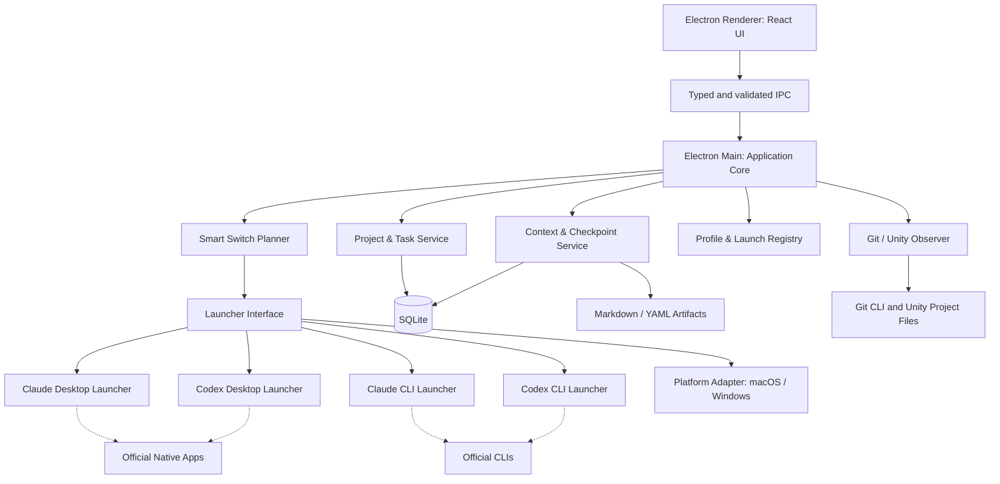
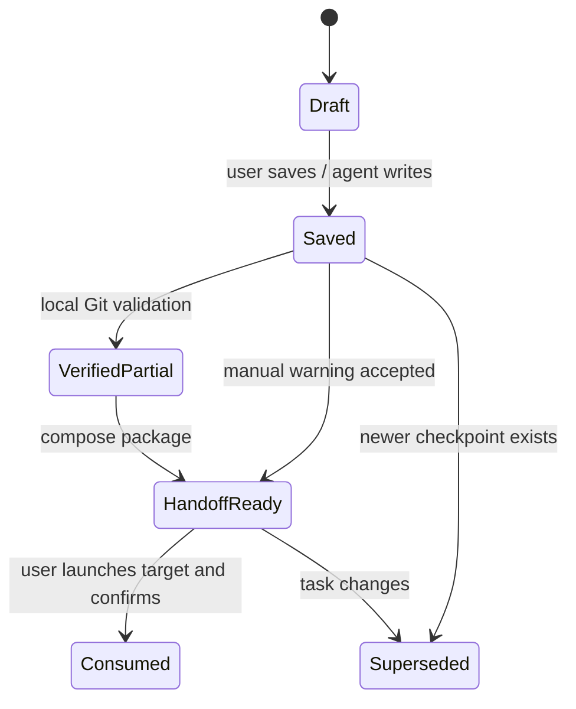
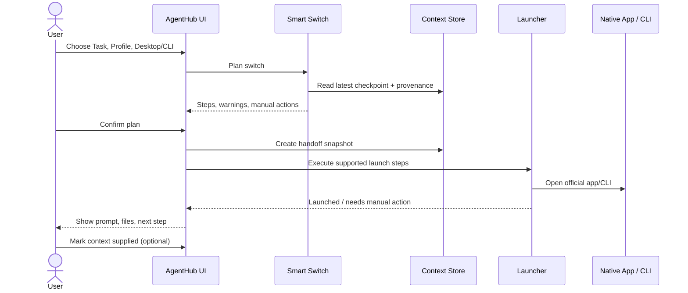

# AgentHub — Technical Design Document (TDD)

> **Project:** AgentHub — Cross-platform AI Agent Workspace & Context Manager  
> **Version:** 0.1.1 (repository structure agreed; pre-implementation)  
> **Updated:** 2026-10-29  
> **Status:** Draft for implementation review  
> **Platforms:** macOS and Windows  
> **Language:** Vietnamese (technical identifiers in English)  
> **Repository location:** `docs/TDD.md`  
> **Source of truth:** This document describes intended behavior, **not** implemented functionality.

---

## 0. Executive summary

AgentHub là desktop application chạy trên **macOS và Windows** để quản lý **Project → Task → Context → Checkpoint → Handoff**, đồng thời hỗ trợ **Claude/Codex Desktop và CLI như các lựa chọn ngang hàng**. Ứng dụng giúp người dùng tạo conversation mới khi chat quá dài, chuyển từ một account/agent sang account/agent khác, hoặc thay đổi Desktop ↔ CLI mà không phải tự viết lại toàn bộ bối cảnh công việc.

**Nhu cầu xuất phát:** Một Unity Developer dùng hai Claude accounts và một Codex account, làm việc trên nhiều Unity projects/Git branches, muốn giảm thời gian đổi công cụ và duy trì context giữa các phiên.

**Thành phần AgentHub sở hữu:**

- Project registry, account **aliases/profile descriptors**, task metadata.
- Project instructions, task context, quyết định, checkpoint, handoff artifacts.
- Smart Switch planning, launch adapters cho CLI và native Desktop app.
- Cross-platform local persistence, Git observation và kiểm tra Unity project cơ bản.

**Thành phần AgentHub không sở hữu:**

- UI chat, native message history, model inference, agent loop, model billing.
- Đăng nhập bên trong Claude/Codex Desktop, chuyển account Desktop không có API chính thức.
- Toàn bộ nội dung hoặc trạng thái của cuộc hội thoại native khi provider không cung cấp API được hỗ trợ.

**Nguyên tắc sản phẩm:** *Chuyển được công việc, không nhất thiết chuyển được nguyên vẹn cuộc hội thoại.* Desktop và CLI có giá trị ngang nhau về UX, nhưng có **khả năng tích hợp kỹ thuật khác nhau**. Nếu không thể tự động hóa một bước, giao diện phải báo rõ bước thủ công còn thiếu.

### 0.1. Quyết định đã chốt

| Mục | Quyết định |
|---|---|
| Product direction | Hybrid Workspace & Context Manager; không xây lại chat app |
| Supported OS | macOS, Windows (native-first trên Windows; WSL optional) |
| Desktop stack | Electron + React + TypeScript |
| Storage | SQLite cho metadata; Markdown/YAML cho context artifacts |
| First integrations | Official Claude Code CLI, Codex CLI, native Desktop launcher |
| Context | Project + Task + Checkpoint + Handoff; độc lập account/provider |
| Account handling | Chọn CLI profile; Desktop account phải được người dùng xác minh khi không có official switch API |
| Smart Switch | Rules-based, human-in-the-loop; không dùng model API |
| Unity/Git | Awareness + safe observation trước; MCP/write automation sau |
| MVP boundary | Không gọi trực tiếp Claude/OpenAI model APIs; không clone chat history |

### 0.2. Thang mức độ cam kết của tích hợp

- **Supported:** Có cơ chế chính thức được tài liệu hóa, nhưng vẫn phải kiểm thử với version trên máy người dùng.
- **Conditional:** Chỉ chạy khi đúng platform, auth mode, provider version hoặc tình trạng session.
- **Manual:** AgentHub chuẩn bị context và mở công cụ; người dùng tự hoàn thành bước trong app gốc.
- **Out of scope:** Không triển khai trong MVP, không ngầm hứa hoạt động.

---

## 1. Product scope & terminology

### 1.1. Định nghĩa

- **Provider:** Claude hoặc Codex.
- **Account profile:** Bản ghi cục bộ về account alias, provider, CLI config root, allowed projects; **không** chứa password/session token.
- **Client mode:** `desktop` hoặc `cli`, được người dùng chọn cho mỗi lần launch.
- **Project:** Thư mục local của Unity project hoặc repository phần mềm khác.
- **Task:** Đơn vị công việc có mục tiêu, tiêu chí hoàn thành, trạng thái và context riêng.
- **Conversation/session:** Cuộc hội thoại thuộc native Claude/Codex, thường do chính ứng dụng đó quản lý.
- **Context artifact:** File Markdown/YAML mô tả thông tin được chủ động lưu lại.
- **Checkpoint:** Snapshot có kiểm soát của tiến độ task tại một thời điểm, không phải transcript đầy đủ.
- **Handoff:** Gói thông tin giúp một session mới tiếp tục task, có thể chuyển account/provider/client mode.
- **Smart Switch:** Bộ quy tắc chọn launcher, chuẩn bị context, nêu rõ limitations và thủ công cần làm.
- **Observed fact:** Thông tin AgentHub tự kiểm tra được (Git status, file path, SHA); khác với nội dung do agent báo cáo.

### 1.2. Vấn đề cần giải quyết

1. Tốn thời gian khi qua lại giữa Claude Account #1, Claude Account #2 và Codex.
2. Khi session quá dài hoặc quota/account trở thành trở ngại, phải tạo chat mới và diễn giải lại công việc.
3. Khó tiếp tục cùng một task trên Claude Desktop, Codex Desktop hoặc CLI.
4. Các native apps có UI và lịch sử chat tốt; làm lại UI là lãng phí.
5. Project/branch/worktree/Unity version dễ bị nhầm khi agent mới nhận task.
6. Những quyết định chỉ còn trong hội thoại cũ dễ mất nếu chưa checkpoint.

### 1.3. Goals

| ID | Goal | Cách đo |
|---|---|---|
| G-01 | Tạo handoff từ task hiện tại sang agent/account bất kỳ | Có artifact và prompt mới xác định nguồn/đích |
| G-02 | Cho phép lựa chọn Desktop hoặc CLI ngang hàng | Hai mode hiện trong cùng launch flow |
| G-03 | Chạy các Claude CLI profiles độc lập | Hai profile có config root khác nhau, chạy song song trên test machine |
| G-04 | Context sống độc lập với Git branch | Đổi branch không làm mất metadata/checkpoint trong AgentHub |
| G-05 | Không giả báo đã đồng bộ native conversation | UI phản ánh đúng mức kiểm soát và độ mới của dữ liệu |
| G-06 | Có ứng dụng cùng tính năng chính trên macOS/Windows | Acceptance tests trên cả hai OS |
| G-07 | Không làm lộ credentials/mã nguồn sang account không được phép | Project–profile allowlist, redaction và confirmation |

### 1.4. Non-goals (MVP)

- Tạo chat client tương đương Claude/Codex Desktop; hiển thị native transcript trong AgentHub.
- OAuth impersonation, tự chuyển account trong Desktop app bằng private endpoints, đọc local DB/Keychain của app khác.
- Tự động đảo account để vượt quota/rate limits, tự động mua/bán hoặc trung gian thanh toán model usage.
- Gọi trực tiếp Anthropic/OpenAI inference APIs; dùng Claude Agent SDK/Codex App Server để xây chat UI.
- Agent tự ra quyết định thay người dùng về task/branch/security/approval.
- Đồng bộ cloud giữa hai máy, sync native conversation, quản lý nhiều người/team.
- Tự động sửa scene/prefab đang mở trong Unity hay giành quyền điều khiển Unity MCP.
- Tự động merge branch hoặc tự khẳng định QA thành công.

### 1.5. Primary user stories

- **US-01:** Với một task đang làm trên Claude Desktop #1, tôi muốn lưu checkpoint và tiếp tục trên Claude Desktop #2 nếu cần, dù có thể phải chuyển account thủ công trong Desktop.
- **US-02:** Tôi muốn chọn Claude CLI profile #2 từ AgentHub và mở session mới tại đúng project kèm handoff.
- **US-03:** Tôi muốn chuyển Claude → Codex Desktop, nhận prompt/handoff dùng ngay mà không viết lại yêu cầu.
- **US-04:** Chat quá dài; tôi muốn tạo chat mới trên cùng provider/account và đọc checkpoint mới nhất.
- **US-05:** Sau khi đổi Git branch, tôi vẫn xem được task và checkpoint của branch cũ.
- **US-06:** Tôi muốn dùng chung workflow trên Mac và Windows, không phải đổi cách tổ chức tài liệu.
- **US-07:** Nếu checkpoint cũ hoặc chưa đầy đủ, AgentHub phải cảnh báo thay vì tự tuyên bố context hoàn chỉnh.

---

## 2. Functional requirements

### 2.1. MVP requirements (P0)

| ID | Requirement | Acceptance |
|---|---|---|
| FR-001 | Add/edit/remove Project | Chọn thư mục, lưu path, validate tồn tại |
| FR-002 | Add/edit Task per Project | Objective, acceptance criteria, trạng thái, notes |
| FR-003 | Manage provider/account aliases | 2 Claude + 1 Codex profile, không lưu bí mật |
| FR-004 | Choose Desktop/CLI per launch | Không ép người dùng chọn CLI thay cho Desktop |
| FR-005 | Launch Claude Code CLI with separate config root | Mỗi profile nhận đúng `CLAUDE_CONFIG_DIR` |
| FR-006 | Launch Codex CLI in target project | Đúng cwd/path, binary chính thức |
| FR-007 | Launch Claude/Codex Desktop via supported mechanism | Đúng app; nhận biết khi không thể mở đúng project/session |
| FR-008 | Manage Project/Task Context | CRUD Markdown, atomic writes, version metadata |
| FR-009 | Generate checkpoint | Agent-authored summary hoặc manual input + Git observations |
| FR-010 | Generate handoff | Mục tiêu, quyết định, pending, file, verification, prompt |
| FR-011 | Smart Switch rule engine | Hiển thị kế hoạch và manual steps trước khi launch |
| FR-012 | Copy/open context artifact | Đưa context vào native Desktop thủ công khi cần |
| FR-013 | Persist data independently of Git branch | Restart và checkout branch không mất task record |
| FR-014 | Accurate status/provenance | Không ghi `synced`, `completed` nếu chỉ mở Desktop |
| FR-015 | macOS + Windows builds | Mỗi OS chạy được smoke tests và launch adapters |
| FR-016 | Project/profile access control | Cảnh báo và chặn profile không được phép |

### 2.2. Follow-up requirements (P1)

- FR-101: Git status, diff summaries, commit SHA, check dirty worktree.
- FR-102: Worktree registry; chỉ hỗ trợ tạo/mở worktree sau khi safety checks.
- FR-103: Tự xác định Unity version và phân biệt Editor instance/worktree.
- FR-104: Shortcut/hotkey, recent tasks, search trong context artifacts.
- FR-105: CLI process status/return code; optional embedded terminal (không phải chat UI).
- FR-106: Tùy chọn explicit task checkpoint reminder, chỉ khi người dùng bật.
- FR-107: Import/export task contexts qua Git; xử lý conflicts bằng review.

### 2.3. Future requirements (P2, chưa cam kết)

- Official session deep links nếu provider công bố giao thức đủ ổn định.
- Read-only MCP/Unity state verification; write ownership chỉ sau safety design.
- Multi-device context synchronization với opt-in encryption.
- Optional SDK integrations nếu mang lại giá trị thực và đáp ứng licensing/auth policies.

### 2.4. Non-functional requirements

| ID | Requirement | Target/behavior |
|---|---|---|
| NFR-001 | Local-first | Không cần AgentHub cloud backend |
| NFR-002 | Data durability | SQLite transaction; temp+rename cho Markdown |
| NFR-003 | Startup behavior | Không đợi provider đăng nhập hoặc model phản hồi mới mở UI |
| NFR-004 | Security | Không lưu password/tokens; không in secrets vào logs |
| NFR-005 | Cross-platform | OS-specific code chỉ nằm trong PlatformAdapter/Launcher |
| NFR-006 | Observability | Structured local logs, mức log có thể cấu hình |
| NFR-007 | Maintainability | TypeScript strict, unit/integration/e2e checks |
| NFR-008 | Accessibility | Keyboard navigation, focus states, readable errors |
| NFR-009 | Privacy | No telemetry mặc định; explicit opt-in nếu thêm sau |
| NFR-010 | Upgrade | Versioned migrations + backups; không âm thầm ghi đè data |

---

## 3. Integration feasibility and policy boundaries

> **Thời điểm tham chiếu:** 2026-10-29. Provider CLIs/apps có thể thay đổi nhanh. Phải kiểm thử với bản cài thực tế và kiểm tra lại điều khoản trước khi phân phối ứng dụng cho người khác. Mục này không phải tư vấn pháp lý.

### 3.1. Capability matrix

| Target | Launch | Set account | Inject context | Get full history | Remarks |
|---|---|---|---|---|---|
| Claude CLI | Supported | Conditional via separate supported config dirs | Prompt/file, verified flags | Không cần cho MVP | User tự đăng nhập từng profile |
| Claude Desktop (Code) | Supported | Manual / not guaranteed | `CLAUDE.md` + user prompt; native resume conditional | Không hứa có API đồng bộ | Phân biệt Code tab với Claude Chat thường |
| Codex CLI | Supported | Theo auth/config của CLI | Prompt/file instructions | Không cần cho MVP | `AGENTS.md` cho repo instruction |
| Codex Desktop | Supported | Manual / not guaranteed | Workspace + context file/prompt | Không hứa có API đồng bộ | Workspace open behavior khác giữa OS |

**Không đồng nhất các khái niệm:** `open app`, `open workspace`, `resume native session`, `switch account`, `inject prompt`, `sync conversation` là những capabilities độc lập. Launcher chỉ quảng bá capability nào đã được xác nhận.

### 3.2. Claude integration

- Claude Code hỗ trợ `CLAUDE_CONFIG_DIR` để đặt vị trí lưu cấu hình, credentials và session history; phù hợp tạo hai CLI profile độc lập. Sử dụng **absolute path** và đặt env riêng cho từng process.
- `CLAUDE.md`/`CLAUDE.local.md` tại project được sử dụng bởi Claude Code CLI và Claude Desktop Code session, theo tài liệu. **Không** suy rộng sang toàn bộ Claude Chat UI hoặc mọi chế độ remote.
- Lệnh `claude --desktop` và `claude --desktop --resume <session-id>` tồn tại ở các bản hỗ trợ; yêu cầu platform/auth/version/session state cụ thể. Theo tài liệu tra cứu: macOS và Windows x64, Claude subscription; không hỗ trợ API-key auth hoặc WSL cho luồng chuyển session cục bộ này.
- Nếu Claude Desktop đang đăng nhập account khác profile CLI, không được tự tuyên bố đã chuyển đúng account; yêu cầu user confirmation.
- Không sửa binary Claude Code, không trích xuất credentials, không làm trung gian billing. Khi phân phối product có khả năng chạy Claude Code, cần rà soát điều khoản Anthropic áp dụng cho bên thứ ba.

**CLI example — macOS** (minh họa, paths thực tế do người dùng thiết lập):

```bash
CLAUDE_CONFIG_DIR="$HOME/.agenthub/claude-a" claude
CLAUDE_CONFIG_DIR="$HOME/.agenthub/claude-b" claude
```

**CLI example — Windows PowerShell** (minh họa):

```powershell
$env:CLAUDE_CONFIG_DIR = "$HOME\.agenthub\claude-a"
claude
# Mở một PowerShell process khác với profile b; không đặt lại env giữa session đang chạy.
```

Khi triển khai Electron, **không** ghép shell command từ input; truyền `cwd` + `env` vào process launcher bằng argument array.

### 3.3. Codex integration

- Codex CLI được mở trong directory của project; instructions ổn định dùng `AGENTS.md`.
- Theo tài liệu chính thức, `codex app PATH` mở ứng dụng/workspace trên macOS; ở Windows, hành vi có thể chỉ mở app và in đường dẫn để người dùng mở. Không coi đây là native thread handoff.
- Account switching trong Codex Desktop không được coi là capability MVP; nếu chưa có public API, người dùng tự xác nhận/sign in trong app gốc.
- Config isolation/CLI auth của Codex phải kiểm thử phiên bản cụ thể; **MVP chỉ cần 1 Codex profile** nên không mặc định thêm logic multi-Codex-account.
- Không dùng internal Desktop DB, private endpoints hay credential files để suy ra session/account.

### 3.4. CLI vs Desktop parity

**Parity về sản phẩm:** UI luôn cho chọn Desktop và CLI. **Không parity về tự động hóa:** CLI thường điều khiển được cwd/env/prompt; Desktop có thể chỉ mở app và yêu cầu người dùng tạo chat/dán prompt. AgentHub phải gắn nhãn `automatic`, `conditional`, `manual` vào từng bước.

### 3.5. Feasibility gates cần làm trước UI lớn

| ID | Spike | Pass criteria |
|---|---|---|
| SPIKE-01 | Claude CLI profile A/B (macOS, Windows) | Hai profile độc lập chạy song song, auth riêng, không lẫn data |
| SPIKE-02 | Claude Desktop launcher | Mở được Code workspace; xác minh điều kiện `--desktop` / `--resume` |
| SPIKE-03 | Codex Desktop launcher | Hành vi thực tế được ghi trên cả macOS/Windows |
| SPIKE-04 | Context instructions recognition | Claude Code đọc `CLAUDE.md`; Codex đọc `AGENTS.md` từ đúng project |
| SPIKE-05 | Account mapping | Không có tuyên bố sai về account native Desktop hiện tại |
| SPIKE-06 | Legal/policy review | Documented integration paths, phân biệt personal-only và phân phối |

**Fallback:** Nếu một launcher không xác minh được session/account, AgentHub vẫn hỗ trợ `Open app` + `Open folder` + `Copy Handoff Prompt`; không chặn toàn bộ workflow.

---

## 4. Architecture overview

### 4.1. Component diagram



**Main Process** chịu trách nhiệm mọi thao tác FS/process/OS; **Renderer** chỉ xem dữ liệu và gọi IPC đã validate. Native apps giữ nguyên nhiệm vụ chat/model/review.

### 4.2. Proposed layers

1. **Presentation:** Project list, Task detail, Context Editor, Smart Switch wizard, Launch history, Settings.
2. **Application services:** Orchestrate task/checkpoint/handoff, validate permissions and capabilities.
3. **Domain:** `Project`, `Task`, `AccountProfile`, `Checkpoint`, `Handoff`, `LaunchAttempt`, value objects và domain rules.
4. **Infrastructure:** SQLite, atomic filesystem writer, Git CLI, process launcher, OS-specific implementation.
5. **Integrations:** Official Claude/Codex CLI binaries và native Desktop launchers; không bao gồm model SDK trong MVP.

### 4.3. Folder/repository structure (agreed)

```text
agent-hub/
├── README.md
├── AGENTS.md                     # Shared agent entrypoint (Codex reads directly)
├── CLAUDE.md                     # Claude entrypoint; imports AGENTS.md
├── .gitattributes                # Line endings for macOS/Windows
├── .gitignore
├── docs/
│   ├── README.md                 # Documentation map
│   ├── TDD.md
│   ├── ROADMAP.md                # Milestones and exit criteria
│   ├── STATUS.md                 # Verified current state
│   ├── DEVELOPMENT.md            # Shared development rules
│   ├── feasibility.md            # Phase 0 plan and evidence
│   └── decisions/               # Architecture Decision Records
├── apps/
│   └── desktop/
│       ├── src/
│       │   ├── main/            # Electron main, IPC, OS/process access
│       │   ├── preload/         # Safe, narrow contextBridge APIs
│       │   └── renderer/        # React components
│       └── tests/
├── packages/
│   ├── domain/                   # Entities, value objects, business rules
│   ├── application/              # Use cases, ports, orchestration
│   ├── contracts/                # IPC DTOs, events, validation schemas
│   ├── persistence/              # SQLite + file store
│   ├── integrations/             # Launcher adapters
│   └── platform/                 # Darwin/Win32 adapters, read-only Git/Unity observers
├── scripts/
└── spikes/                       # Isolated feasibility experiments
    └── <spike-name>/
        ├── evidence/             # Sanitized evidence, committed
        └── local/                # Raw local output, ignored
```

Cấu trúc monorepo với các package boundaries trên đã được người dùng chốt ngày 2026-10-29; xem [ADR-012](decisions/012-initial-package-boundaries.md). Package directories được tạo ngay trong repository foundation. Workspace manifests, package manager, build tool và dependency versions sẽ được quyết định ở technical bootstrap, sau Phase 0.

`application` phụ thuộc `domain` và định nghĩa các port cho persistence, launcher và platform. Các package hạ tầng triển khai port; Electron Main khởi tạo và kết nối implementation. `integrations` nhận platform port qua dependency injection. `contracts` chứa hợp đồng truyền dữ liệu độc lập với Electron/Node và domain implementation; Renderer/Preload chỉ dùng hợp đồng cùng API được expose. Quy tắc chi tiết ở [DEVELOPMENT.md](DEVELOPMENT.md).

Tài liệu hiện dùng tiếng Việt, giữ tên file và thuật ngữ kỹ thuật bằng tiếng Anh. Khi chuyển sang tiếng Anh, giữ đường dẫn tài liệu ổn định. SQLite và artifacts do ứng dụng sinh ra vẫn nằm ngoài repository theo §6; tài liệu phát triển trong `docs/` không phải runtime artifact store.

### 4.4. Main interfaces (illustrative TypeScript)

```ts
type Provider = 'claude' | 'codex';
type ClientMode = 'desktop' | 'cli';
type SupportLevel = 'supported' | 'conditional' | 'manual' | 'unsupported';

type LauncherCapabilities = {
  openApp: SupportLevel;
  openWorkspace: SupportLevel;
  selectAccount: SupportLevel;
  resumeNativeSession: SupportLevel;
  injectContext: SupportLevel;
};

type LaunchRequest = {
  projectId: string;
  taskId: string;
  provider: Provider;
  profileId: string;
  mode: ClientMode;
  contextSnapshotId?: string;
  nativeSessionId?: string;  // optional; only use if provider supports it
};

type PlannedStep = {
  label: string;
  execution: 'automatic' | 'conditional' | 'manual';
  warning?: string;
};

type LaunchPlan = {
  request: LaunchRequest;
  steps: PlannedStep[];
  requiredConfirmations: string[];
  capabilityVersion: string;
};

interface Launcher {
  getCapabilities(): Promise<LauncherCapabilities>;
  plan(request: LaunchRequest): Promise<LaunchPlan>;
  launch(plan: LaunchPlan): Promise<LaunchResult>;
}
```

`plan()` không được gọi model API. `launch()` không tự động trả về `sessionReady` nếu chỉ gọi OS để mở native app. `LaunchResult` phải phân biệt `appOpened`, `workspaceOpened`, `sessionStarted` và `userActionRequired`.

### 4.5. Typed IPC (proposal)

| Channel | Direction | Data |
|---|---|---|
| `projects:list` | Renderer → Main | Search/filter |
| `projects:add` | Renderer → Main | Validated path |
| `tasks:create` | Renderer → Main | Project ID + task fields |
| `context:save` | Renderer → Main | Text + expected revision |
| `checkpoint:create` | Renderer → Main | Task ID + structured sections |
| `handoff:preview` | Renderer → Main | Task ID + target profile/mode |
| `launch:plan` | Renderer → Main | LaunchRequest |
| `launch:execute` | Renderer → Main | Plan ID + confirmations |
| `launch:status` | Main → Renderer | Verified launch states |

Preload expose **chỉ** những methods đã định nghĩa; không expose `ipcRenderer`, `child_process` hoặc filesystem trực tiếp cho React UI.

---

## 5. Cross-platform design

### 5.1. Runtime responsibilities

| Concern | macOS adapter | Windows adapter |
|---|---|---|
| App data | `~/Library/Application Support/AgentHub/` | `%APPDATA%\AgentHub\` (theo Electron `app.getPath('userData')`) |
| Open native app | Official CLI hoặc OS open mechanism | Official CLI hoặc OS open mechanism |
| Terminal | Terminal.app / iTerm if configured | Windows Terminal / PowerShell if configured |
| Process args | `spawn(executable, args, { cwd, env })` | Tương tự; xử lý `.cmd`, `PATHEXT` qua safe resolution |
| Paths | POSIX paths | Win32 paths / case-insensitive / drive letters |
| Credentials | Provider quản lý; AgentHub không đọc | Provider quản lý; AgentHub không đọc |
| WSL | Not applicable | Optional explicit user-configured execution target |
| Packaging | Code signing / notarization (for distribution) | Code signing / installer (for distribution) |

**Path policy:** Persist absolute OS-specific project paths theo từng installation, không chép trực tiếp Mac path sang Windows. Dùng `projectId` ổn định + per-device path mapping khi thêm Git sync sau này.

### 5.2. Process launching safety

- Resolve executable từ cấu hình hoặc PATH; kiểm tra tồn tại và hiển thị resolved path cho người dùng.
- Không dùng `exec('claude ... ' + userInput)`; ưu tiên argument arrays và `shell: false` khi khả thi.
- Đưa profile qua environment của **child process**, không thay toàn bộ user environment.
- Trên Windows, test cách mở CLI `.exe`/`.cmd` qua launch target được hỗ trợ; không giả định POSIX PTY có trên Windows.
- Cho phép `cwd` chỉ trong project đã đăng ký hoặc worktree được người dùng chọn.
- Không tự đóng native Desktop app khi người dùng đóng AgentHub.
- Không tự kill terminal/CLI process đã detach nếu chưa có quyết định lifecycle được ghi rõ.
- Capture launch exit code/stderr giới hạn, redact credentials và paths nhạy cảm trong diagnostic logs.

### 5.3. Windows-native vs WSL

Windows-native CLI là default nếu tương thích với version đã cài. WSL là **optional explicit mode**, vì `C:\Project` và `/mnt/c/Project` có semantics khác, và Unity Editor thường chạy trên Windows host. Nếu hỗ trợ WSL sau MVP, adapter phải map path, cwd, binary và auth profile một cách riêng biệt; không tự chuyển đổi ngầm.

### 5.4. OS test matrix

- macOS Apple Silicon, latest supported OS phiên bản dự án đã quyết định.
- Windows 11 x64; làm rõ yêu cầu Windows 10 qua ADR nếu cần.
- Claude Code install/version khác nhau; Codex install/version khác nhau.
- Có/không cài Desktop app, có/không cài CLI.
- Git repo dirty/clean, path có khoảng trắng và Unicode, thư mục không có quyền ghi.
- Auth valid/expired/unknown — không đọc credentials để quyết định.

---

## 6. Local storage & data model

### 6.1. Storage strategy

- **SQLite:** Project, Task, Profile descriptors, Checkpoint index, Handoff index, Launch history, per-device settings.
- **Artifact store:** Markdown/YAML được tạo và có thể mở ngoài ứng dụng; dùng UUID paths hoặc deterministic task IDs.
- **Git repo:** Không phải primary database của app. Chỉ export những docs được chọn và an toàn để commit.
- **Secrets:** AgentHub không lưu subscription credentials; nếu về sau có secret cấu hình riêng, bắt buộc dùng native secure storage và thiết kế lại threat model.

### 6.2. Proposed SQLite schema (draft)

```sql
CREATE TABLE projects (
  id TEXT PRIMARY KEY,
  name TEXT NOT NULL,
  created_at TEXT NOT NULL,
  updated_at TEXT NOT NULL
);

CREATE TABLE project_locations (
  id TEXT PRIMARY KEY,
  project_id TEXT NOT NULL REFERENCES projects(id),
  device_id TEXT NOT NULL,
  absolute_path TEXT NOT NULL,
  UNIQUE(project_id, device_id)
);

CREATE TABLE tasks (
  id TEXT PRIMARY KEY,
  project_id TEXT NOT NULL REFERENCES projects(id),
  title TEXT NOT NULL,
  objective TEXT NOT NULL,
  acceptance_criteria TEXT NOT NULL DEFAULT '',
  status TEXT NOT NULL CHECK(status IN
    ('backlog','active','blocked','in_review','done','archived')),
  created_at TEXT NOT NULL,
  updated_at TEXT NOT NULL
);

CREATE TABLE account_profiles (
  id TEXT PRIMARY KEY,
  provider TEXT NOT NULL CHECK(provider IN ('claude','codex')),
  alias TEXT NOT NULL,
  cli_config_root TEXT,
  enabled INTEGER NOT NULL DEFAULT 1,
  created_at TEXT NOT NULL
);

CREATE TABLE project_profile_permissions (
  project_id TEXT NOT NULL REFERENCES projects(id),
  profile_id TEXT NOT NULL REFERENCES account_profiles(id),
  allowed INTEGER NOT NULL,
  PRIMARY KEY(project_id, profile_id)
);

CREATE TABLE checkpoints (
  id TEXT PRIMARY KEY,
  task_id TEXT NOT NULL REFERENCES tasks(id),
  artifact_path TEXT NOT NULL,
  source_type TEXT NOT NULL,       -- manual | agent_supplied | git_observed
  git_sha TEXT,
  revision INTEGER NOT NULL,
  created_at TEXT NOT NULL
);

CREATE TABLE handoffs (
  id TEXT PRIMARY KEY,
  task_id TEXT NOT NULL REFERENCES tasks(id),
  checkpoint_id TEXT REFERENCES checkpoints(id),
  source_profile_id TEXT REFERENCES account_profiles(id),
  target_profile_id TEXT REFERENCES account_profiles(id),
  target_mode TEXT NOT NULL CHECK(target_mode IN ('desktop','cli')),
  artifact_path TEXT NOT NULL,
  created_at TEXT NOT NULL
);

CREATE TABLE launch_attempts (
  id TEXT PRIMARY KEY,
  task_id TEXT NOT NULL REFERENCES tasks(id),
  profile_id TEXT NOT NULL REFERENCES account_profiles(id),
  mode TEXT NOT NULL CHECK(mode IN ('desktop','cli')),
  status TEXT NOT NULL,            -- planned | launched | manual_step | failed
  external_session_ref TEXT,       -- nullable, only verified native ref
  error_code TEXT,
  created_at TEXT NOT NULL
);
```

**Implementation rules:** timestamps UTC ISO-8601; IDs UUID; indexes trên `tasks(project_id)`, `checkpoints(task_id, created_at)` và `launch_attempts(task_id, created_at)`; foreign keys enabled; versioned migrations. Không suy ra profile đăng nhập Desktop từ field `profile_id`.

### 6.3. Local artifact layout

```text
<AgentHub userData>/
├── agenthub.sqlite
├── backups/
├── artifacts/
│   └── <project-id>/
│       └── <task-id>/
│           ├── task.md
│           ├── decisions.md
│           ├── checkpoints/
│           │   └── <checkpoint-id>.md
│           └── handoffs/
│               └── <handoff-id>.md
└── logs/
```

**Important:** `artifacts/` là dữ liệu local chính. File `.agenthub/` trong Git project (nếu có) là **exported copy**, không phải bản duy nhất.

### 6.4. Migrations, backup, conflict behavior

- SQLite migrations chạy trong transaction; backup trước schema upgrade lớn.
- File save bằng temporary file cùng filesystem rồi atomic rename; dùng checksum/revision để tránh ghi đè từ hai cửa sổ app.
- Khi export vào Git gặp file khác nội dung, yêu cầu compare/merge, không tự overwrite.
- App crash sau khi ghi file nhưng trước khi ghi DB phải được recovery scan và đánh dấu orphan artifact, không tự xóa.
- Không xóa context artifact khi xóa CLI session hoặc khi checkout branch.

---

## 7. Context, checkpoints and handoffs

### 7.1. Source of truth

Ba cấp dữ liệu:

| Scope | Nội dung | Update frequency |
|---|---|---|
| Project Context | Kiến trúc, Unity version, conventions, repo constraints | Thấp |
| Task Context | Objective, decisions, acceptance criteria, current focus | Trung bình |
| Checkpoint/Handoff | What changed, verified facts, pending steps, blockers | Theo từng mốc |

`CLAUDE.md` và `AGENTS.md` là provider instruction entrypoints, không phải bản lưu toàn bộ task history. Có thể tạo các entrypoints ngắn, liên kết đến tài liệu project và checkpoint hiện tại. Không tự sửa các file hướng dẫn hiện có nếu chưa được user review.

### 7.2. Checkpoint Markdown contract

```markdown
---
kind: agenthub.checkpoint
schema_version: 1
task_id: QA-024
checkpoint_id: <uuid>
created_at: <utc-iso8601>
source: user_or_agent
project_id: <uuid>
workspace_path: <local-path>
branch: feature/camera
git_sha: <sha-or-null>
verification: partial
---

# Checkpoint — QA-024

## Objective
...

## Completed work (reported)
- ...

## Verified observations
- Git changes: ...
- Tests actually run: ...

## Decisions and rationale
- ...

## Pending / blockers
- ...

## Files to inspect
- ...

## Handoff warnings
- Unverified information: ...
```

**Provenance contract:** `reported`, `observed`, `verified` phải khác nhau. Git diff là quan sát file thay đổi, **không** chứng minh chức năng đúng. Không dùng nhãn `completed` nếu chỉ có AI báo cáo nhưng chưa được người dùng/kiểm thử xác nhận.

### 7.3. Handoff schema

```yaml
kind: agenthub.handoff
schema_version: 1
handoff_id: <uuid>
task_id: QA-024
source:
  provider: claude
  account_alias: Claude-A
  client_mode: desktop
  checkpoint_id: <uuid>
target:
  provider: codex
  account_alias: Codex
  client_mode: desktop
workspace:
  project_id: <uuid>
  branch: feature/camera
  git_sha: <sha-or-null>
context:
  project_doc: project.md
  task_doc: task.md
  checkpoint_doc: checkpoints/<uuid>.md
warnings:
  - Native chat history is not automatically transferred
  - Check target account before pasting company context
manual_steps:
  - Open target native app
  - Confirm target account
  - Start a new conversation and paste prompt / attach files
```

### 7.4. Handoff prompt (template)

```text
Bạn đang tiếp tục một task đã được làm ở phiên AI khác.

Project: {projectName}
Task: {taskId} — {taskTitle}

Hãy đọc (hoặc sử dụng các file được đính kèm):
- {taskContextPath}
- {checkpointPath}
- {handoffPath}

Quy tắc:
1. Kiểm tra project path và Git branch trước khi chỉnh sửa.
2. Phân biệt thông tin được báo cáo với trạng thái file/kiểm thử thực tế.
3. Không giả định conversation cũ được chuyển nguyên vẹn.
4. Tóm tắt hiểu biết, nêu phần chưa chắc chắn, rồi mới tiếp tục pending steps.
5. Trước khi kết thúc, cập nhật checkpoint theo cấu trúc của AgentHub.
```

**Desktop Chat vs Code:** Với Claude/Codex chat surface không hỗ trợ đọc local file theo cùng cơ chế như coding mode, sử dụng copy prompt + attach/import file hoặc workspace feature chính thức; không giả định tự động load local path.

### 7.5. Checkpoint lifecycle



Lưu ý: `Consumed` nghĩa là người dùng xác nhận đã đưa context vào target, **không** chứng minh model đích đã hiểu hay đã thực hiện chính xác.

### 7.6. Tránh mất context khi quota chạm giới hạn

- Khuyến khích checkpoint **trước** khi kết thúc một mốc lớn hoặc đổi session; không dựa vào khả năng gọi lại agent sau khi quota hết.
- Cung cấp `Checkpoint Now` với template có thể copy vào native chat; nếu CLI hỗ trợ input flow hợp lệ thì cho phép paste/start command.
- Nếu không tạo được agent-authored summary, vẫn tạo partial handoff từ task metadata + checkpoint cũ + Git observations.
- UI hiển thị `Stale checkpoint`, `Unverified decisions` khi có branch/SHA mismatch hoặc checkpoint quá cũ; không tạo cảm giác an toàn giả.
- Tạo chat mới không tự làm mới quota account; profile switch chỉ sử dụng account hợp lệ theo quy định provider.

---

## 8. Smart Switch — decision engine

### 8.1. Inputs/outputs

Inputs: current Project/Task; source provider/profile/client; target provider/profile/client; current checkpoint; target workspace; observed Git state; launcher capabilities.

Outputs: **LaunchPlan** có list bước tự động, conditional, manual, warnings, user confirmations và kết quả dự kiến. Không gọi model inference trong bước planning.

### 8.2. Decision table

| Source → Target | Automatic | Manual / conditional |
|---|---|---|
| Claude Desktop A → Claude Desktop B | Prepare handoff, open app | Confirm/switch Desktop account, start chat, paste context |
| Claude Desktop A → Claude CLI B | Prepare handoff, launch CLI with config B | Confirm target CLI already signed in; verify prompt received |
| Claude Desktop → Codex Desktop | Create Codex handoff, open app/workspace | Confirm Codex account, new conversation and context import |
| Claude CLI → Codex CLI | Prepare handoff, launch CLI at cwd | Confirm session/prompt and project state |
| Codex Desktop → Claude Desktop | Prepare Claude handoff, open app | Verify Claude account and import context |
| Same Desktop, new chat | Prepare latest checkpoint | User opens chat and submits context |
| Claude CLI → Claude Desktop, same native session | Try documented resume only if supported | Check version/platform/auth, session not active; else manual handoff |
| Same task, different Git branch | Verify workspace target | Explicit user confirmation to avoid wrong branch |

### 8.3. UX sequence



### 8.4. Smart Switch guardrails

1. Never claim `switched account` just because an app window opened.
2. Never claim native chat resumed unless provider confirmed that exact session ID.
3. Confirm when moving content to a different account/provider, especially corporate source code.
4. Abort if target project path is missing or allowlist denies selected profile.
5. Generate handoff before opening target, and save it even if launch fails.
6. Refresh Git observation after launch only when user initiates, or via well-defined read-only watcher.
7. Fall back to manual Desktop flow when integration is conditional/unavailable.

---

## 9. UX / information architecture

### 9.1. Top-level screens

1. **Projects:** Recent projects, Unity version (if detected), repo/worktree, active tasks.
2. **Task Detail:** Objective, acceptance criteria, decisions, latest checkpoint, Git observations.
3. **Switch & Launch:** Choose Agent → Account Profile → Desktop/CLI → Context → Review Plan.
4. **Context Editor:** Edit task/decision Markdown, preview, history and warnings.
5. **History:** Launch attempts, checkpoint index, handoff artifacts (not native chat transcript).
6. **Settings:** Binary discovery, terminal preference, profile config roots, OS behavior, backups.

### 9.2. Primary flow

`Project → Task → [Checkpoint / New conversation] → Target Provider → Account → Desktop / CLI → Review Plan → Launch → Context supplied`.

**Desktop and CLI are siblings in the same selection control.** CLI không được đặt làm mặc định bắt buộc chỉ vì khả năng automation cao hơn.

### 9.3. Minimum screen states

- `No project selected`, `Missing CLI`, `Desktop not installed`, `Profile not configured`.
- `Ready for launch`, `App opened`, `Manual action required`, `Launch failed`.
- `Checkpoint stale`, `Task has uncommitted changes`, `External session state unknown`.
- `Disallowed project/profile pair`, `Context contains sensitive paths`, `Workspace mismatch`.

### 9.4. Workflow acceptance scenarios

**Scenario A — Claude Desktop A → Claude Desktop B**

1. User chọn `Checkpoint` cho QA-024; checkpoint file tồn tại.
2. Chọn Claude profile B + Desktop.
3. App hiện cảnh báo việc chuyển account native là manual nếu không được hỗ trợ.
4. App mở Claude Desktop, hiển thị link file và copy-ready prompt.
5. User xác nhận account B + đã dán context; AgentHub ghi lịch sử handoff, không khẳng định native sync.

**Scenario B — Claude Desktop A → Claude CLI B**

1. App tạo handoff từ checkpoint.
2. App mở terminal với `cwd` đúng và `CLAUDE_CONFIG_DIR` của B.
3. CLI tự xử lý login (nếu cần); app không thu thập credential.
4. User bắt đầu session bằng prompt/context đã chuẩn bị.

**Scenario C — Claude → Codex Desktop**

1. App chuẩn bị handoff có nguồn/provenance.
2. App mở Codex Desktop và workspace khi cơ chế hỗ trợ.
3. User kiểm tra account, tạo chat mới, nhập prompt và đọc artifact.
4. AgentHub chỉ ghi `context supplied` khi user xác nhận, không đọc native chat.

**Scenario D — Same account, new conversation**

1. User chọn `New chat with latest checkpoint`.
2. App kiểm tra latest revision và cảnh báo nếu branch/SHA đã thay đổi.
3. App không xóa cuộc hội thoại cũ; tạo handoff cho chat mới.

---

## 10. Git and Unity integration

### 10.1. Read-only MVP observations

- Git repo root, current branch, current commit SHA, dirty/clean, changed file names.
- Unity version từ `ProjectSettings/ProjectVersion.txt` nếu file tồn tại.
- Nhận biết một project Unity bằng các dấu hiệu như `Assets/`, `Packages/`, `ProjectSettings/`; không yêu cầu mọi registered project đều là Unity.
- Cho phép người dùng chỉ định Unity Editor path/active worktree thủ công nếu có nhiều project copies.

### 10.2. Safety rules

- Không dùng file modification time để khẳng định agent nào đã sửa file; attribution cần chứng cứ/process tracking cụ thể.
- Không tự checkout branch, reset, clean, stash, cherry-pick hoặc merge trong MVP.
- Không tự chép `.unity`, `.prefab`, `.meta` giữa worktrees bằng thủ thuật có thể làm hỏng GUID/references.
- Git changes là observation; không thay thế build/Editor validation.
- Mọi thao tác write qua Unity MCP là out of scope bản đầu tiên.

### 10.3. Potential P1 worktree model

Một Task có thể có `worktreeId` và `workspacePath` riêng. Khi tạo/mở worktree cần kiểm tra repo path, branch already checked out, dirty main workspace, submodules/LFS, disk space, Unity Library import cost. Không mở nhiều Unity Editors trên cùng worktree nếu không có explicit confirmation.

---

## 11. Security, privacy, threat model

### 11.1. Trust boundaries

- Electron Renderer là UI layer có input không đáng tin cậy; Main Process là privileged boundary.
- Provider apps/CLIs là external processes, không nằm trong security boundary của AgentHub.
- Context artifacts là untrusted input vì có thể do model viết; tuyệt đối không thực thi lệnh embedded trong file.
- Project files có thể chứa company code, account settings, proprietary assets.

### 11.2. Threats and controls

| Threat | Control |
|---|---|
| Clipboard/Markdown chứa prompt injection | Hiển thị artifact để review; không thực thi instruction như shell command |
| Shell command injection qua path/task title | `spawn` + args + validation; không concat into shell |
| Mã nguồn gửi nhầm personal profile | Project–profile allowlist + explicit confirmation |
| Tokens xuất hiện trong logs | No credential ingestion, redact stdout/stderr diagnostics |
| Native app đổi account nhưng AgentHub không biết | `Account unverified` badge + manual confirmation |
| File bị ghi đè sau checkout/switch | Store outside repo + revision/checksum |
| Untrusted Git repo config/hooks | Chỉ chạy Git read-only commands đã allowlist trong MVP |
| Local malware đọc context | OS file permissions; optional encryption at rest later |
| App update làm hỏng DB | Migrations, backups, rollback plan |

### 11.3. Electron configuration

- `contextIsolation: true`, `nodeIntegration: false`, sandbox renderer where compatible.
- Content Security Policy hạn chế remote resources/scripts.
- Strict typed IPC; reject unknown channel and malformed args.
- External links mở qua allowlisted protocols; chặn arbitrary `file://`/custom URL launch.
- Không chạy remote code từ task Markdown hoặc untrusted website.
- Local logs có rotation và nút clear data; crash reports/telemetry mặc định off.

### 11.4. Credentials and account policy

- Profile alias không đồng nghĩa xác thực: `Claude-A` chỉ là label cấu hình.
- Chỉ CLI/desktop app chính thức thực hiện login/logout.
- Không copy auth files hoặc session tokens giữa profiles.
- Không tự động tăng cường số lượng account để vượt rate/usage restrictions.
- Nếu phát hành cho công ty/người dùng khác, thực hiện legal/licensing review và kiểm tra IT/data-handling policy trước release.

---

## 12. Logging and error handling

### 12.1. Event categories

- `project.opened`, `task.updated`, `checkpoint.saved`, `handoff.generated`.
- `launch.planned`, `launch.executed`, `launch.manual_action_required`, `launch.failed`.
- `git.observation_completed`, `git.observation_failed`, `context.stale_detected`.

**Không log:** prompt/chat đầy đủ mặc định, credentials, access tokens, private env values, raw native transcript.

### 12.2. Error codes (draft)

| Code | Meaning | UX response |
|---|---|---|
| `BIN_NOT_FOUND` | CLI executable missing | Hướng dẫn cài / chọn path |
| `APP_NOT_FOUND` | Native Desktop missing | Mở link cài đặt hoặc dùng CLI |
| `PROFILE_CONFIG_MISSING` | CLI profile chưa setup | Mở setup wizard |
| `PROJECT_PATH_MISSING` | Project moved/deleted | Relink location |
| `PROFILE_NOT_ALLOWED` | Project access denied | Chọn allowed account hoặc xác nhận policy |
| `CONTEXT_STALE` | Git SHA/branch differs | Review changes before handoff |
| `LAUNCH_UNSUPPORTED` | Feature not supported | Manual fallback |
| `LAUNCH_FAILED` | Process/OS error | Show sanitized error + retry |
| `CHECKPOINT_CONFLICT` | Concurrent document edits | Open diff/resolve |
| `EXTERNAL_STATE_UNKNOWN` | Native session unobservable | Do not infer status |

---

## 13. Implementation plan and acceptance gates

**Chú ý:** đây là các milestone theo mức phụ thuộc, **không phải ước lượng lịch thời gian**. Không bắt đầu giai đoạn sau khi chưa đạt exit criteria của giai đoạn trước.

### Phase 0 — Feasibility spike (mandatory)

**Deliverables:** `docs/feasibility.md`, capability matrix per OS/provider version, minimal throwaway launcher prototypes.

**Tasks:**

1. Xác nhận exact CLI version, executable location, login mode trên macOS và Windows.
2. Kiểm thử Claude profile A/B bằng `CLAUDE_CONFIG_DIR`, đảm bảo không lẫn context/credentials.
3. Kiểm thử `claude --desktop` và (khi đủ điều kiện) `--resume` với subscription và session state.
4. Kiểm thử `codex app <path>` trên cả hai OS, ghi nhận khác biệt behavior.
5. Kiểm chứng `CLAUDE.md`/`AGENTS.md` được coding modes đọc từ đúng root.
6. Kiểm tra terms/licensing integration, phân biệt personal tool và third-party distributed product.

**Exit criteria:** Có bảng capability thực tế; những điểm không hỗ trợ có fallback manual rõ ràng; không có giả định block toàn bộ workflow.

### Phase 1 — Cross-platform shell and data

**Deliverables:** Electron UI, Project/Task CRUD, SQLite migrations, artifact store, basic settings.

**Exit criteria:** Trên Mac/Windows có thể thêm project, tạo task, sửa context, restart app mà không mất dữ liệu; path có Unicode/spaces hoạt động.

### Phase 2 — Equal Desktop/CLI launchers

**Deliverables:** Profile manager, Claude/Codex launch adapters, OS-specific launcher, launch audit/history.

**Exit criteria:** Chọn cùng task rồi mở bằng Desktop hoặc CLI từ cùng một UI. Hai Claude CLI profiles hoạt động độc lập. Desktop account chưa xác minh được phải hiển thị là `unverified`, không `switched`.

### Phase 3 — Checkpoint & Handoff engine (**MVP complete**)

**Deliverables:** Checkpoint editor, handoff generator, Smart Switch wizard, copy/open context, manual confirmation.

**Exit criteria:** Chạy thành công scenarios A–D ở §9.4, bao gồm chat mới cùng account, Claude A → Claude B và Claude → Codex Desktop/CLI. Không dùng model APIs.

### Phase 4 — Git/Unity context (P1)

**Deliverables:** Git observations, Unity version detector, branch/SHA stale warnings.

**Exit criteria:** Handoff ghi đúng branch/SHA và changed file names; cảnh báo khi branch changed; không thay đổi file Unity.

### Phase 5 — Robustness and convenience (P1)

**Deliverables:** Backup/restore, improved launcher diagnostics, hotkeys, export to Git, optional terminal integration.

**Exit criteria:** Recovery sau app crash, SQLite migration tests, Windows/macOS signed builds theo chiến lược phát hành.

### Phase 6 — Optional expansion (P2)

**Candidates:** Provider official deep linking, read-only Unity MCP, richer session recognition, team sync. Chỉ đưa vào scope sau khi có capability/terms validation và nhu cầu thực tế.

---

## 14. Testing and quality gates

### 14.1. Unit tests

- Smart Switch decision table toàn bộ provider/profile/client combinations.
- Handoff generation với missing/stale checkpoint.
- Project-profile allowlist và sensitive-context warnings.
- Validation của IDs, paths, schema versions, revision conflicts.
- Capability flags không được suy diễn từ điều kiện `appOpened`.

### 14.2. Integration tests

- SQLite migrations, concurrent save prevention, temp+rename atomic writer.
- Mock Launcher ghi nhận args/env/cwd (assert không có shell injection).
- Git observer read-only trên temp repositories: dirty, clean, branch, detached HEAD.
- Unity detector trên fixture ProjectVersion.txt.
- OS launch adapter smoke tests trên Mac runner và Windows runner.

### 14.3. E2E tests

- Onboarding → add project → task → checkpoint → switch Claude A CLI → Claude B CLI.
- Claude Desktop → Codex Desktop với manual steps, prompt copy, user confirmation.
- Same Desktop/new chat flow không làm thay đổi conversation cũ.
- Restart app giữa lúc `launch.manual_action_required`: handoff vẫn tồn tại.
- Project directory moved: relink và không mất task metadata.
- Export context vào Git khi target file đã tồn tại: conflict review thay vì overwrite.

### 14.4. Negative tests

- CLI missing, desktop missing, wrong cwd, permission denied, expired auth.
- Checkpoint chứa string có shell metacharacters; không bị thực thi.
- CLI profile paths chứa spaces/Unicode; đúng env per process.
- Git branch mismatch; profile disallowed for company project.
- Native session status unavailable; UI vẫn hiển thị `unknown`.

### 14.5. Definition of Done (for MVP)

- Tất cả FR P0 có tests hoặc manual acceptance evidence trên cả Mac/Windows.
- Có thể hoàn thành ít nhất 4 workflow ở §9.4.
- Không có account impersonation/token scraping/direct inference API dependencies.
- Tài liệu README, TDD, troubleshooting, migration and backup instructions hiện diện.
- Security review: no dangerous IPC, no shell concat, no credential logging.
- AgentHub có thể hoạt động khi provider binaries không cài sẵn (báo lỗi đúng, không crash).

---

## 15. Architecture Decision Records (ADRs)

| ADR | Decision | Status | Rationale |
|---|---|---|---|
| ADR-001 | Electron + React + TS | Accepted | Cross-platform, process/OS integration |
| ADR-002 | Hybrid Desktop & CLI parity | Accepted | Người dùng muốn chọn native UI hoặc terminal tùy task |
| ADR-003 | No chat UI reconstruction | Accepted | Tránh nhân bản tính năng provider đã làm tốt |
| ADR-004 | SQLite + Markdown local-first | Accepted | Bền vững, Git-friendly, không phụ thuộc cloud |
| ADR-005 | Rules-based Smart Switch | Accepted | Predictable, no model API, auditability |
| ADR-006 | Native Desktop account switch is manual fallback | Accepted for MVP | Chưa có public capability chung đáng tin cậy |
| ADR-007 | No direct inference API/SDK in MVP | Accepted | Tránh scope/terms/auth complexity không cần thiết |
| ADR-008 | Git read-only observation first | Accepted | Giảm nguy cơ sửa nhầm Unity project |
| ADR-009 | CLI terminal: external vs embedded | Open | MVP external terminal; optional embedded after validation |
| ADR-010 | Windows minimum version | Open | Test Windows 11 first; decide Windows 10 later |
| ADR-011 | Context export policy | Open | Opt-in per task/project; không tự commit credentials |
| [ADR-012](decisions/012-initial-package-boundaries.md) | Monorepo package boundaries from the start | Accepted | Tách domain, application, contracts và hạ tầng ngay trong cấu trúc ban đầu |

Các ADR-001–ADR-011 hiện được ghi trong bảng này. [ADR index](decisions/README.md) dẫn đến nguồn của từng quyết định; chưa tạo bản sao riêng cho các ADR cũ.

---

## 16. Open questions and explicit assumptions

1. **Claude Desktop scope:** Bạn chủ yếu dùng Claude Code **Code tab** hay Claude Chat thông thường? Hai chế độ khác nhau về khả năng đọc local project context. MVP phải hỗ trợ manual attachment/prompt cho chế độ không tự đọc file.
2. **Account identities:** Hai Claude accounts là personal subscriptions, organization identities hay hỗn hợp? Điều này ảnh hưởng điều kiện Desktop resume, project allowlist và legal compliance.
3. **Distribution:** AgentHub là công cụ cá nhân hay dự định công bố/bán cho người khác? Tình huống phân phối cần compliance review nghiêm ngặt hơn.
4. **Windows support:** Windows 11 x64 có đủ cho MVP không, hay cần Windows 10/ARM64?
5. **Task source:** Tạo task trong AgentHub, nhập từ Notion/Jira, hay chỉ link tới tài liệu ngoài? MVP mặc định task tạo thủ công.
6. **Context update:** User chủ động bấm `Checkpoint Now` hay muốn hook hỗ trợ agent cập nhật file tự động? Mặc định user-triggered để kiểm soát nguồn dữ liệu.
7. **Git branch handling:** Mặc định không ghi context vào repo; chọn export theo task có phù hợp workflow không?
8. **Corporate privacy:** Account nào được phép đọc project/source code nội bộ? Cần cấu hình profile allowlist trước khi dùng ở môi trường công ty.
9. **Desktop automation:** Nếu tương lai provider công bố supported deep link/API, mức độ tự động hóa nào thật sự tiết kiệm thao tác đủ để bổ sung?
10. **Session association:** Có cần lưu native session ID thủ công để thuận tiện mở lại, dù không bảo đảm API resume?

**Các câu hỏi trên không chặn việc bắt đầu Phase 0**. Khi chưa có câu trả lời, dùng default an toàn được ghi rõ và không tự suy diễn quyền truy cập.

---

## 17. Risks and mitigations

| Risk | Severity | Mitigation |
|---|---|---|
| Native Desktop account switching không có API | High | Confirm account manually; CLI profile switching |
| Claude integration/policy thay đổi | High | Official binaries, capability gating, periodic review |
| User hết quota trước checkpoint | High | Periodic user checkpoints; partial handoff từ Git/metadata |
| Context stale sau nhiều chỉnh sửa ngoài AgentHub | High | SHA/branch + manual validation; staleness warnings |
| Project/profile lệch quyền truy cập công ty | Critical | Allowlist, provider/account confirmation, no auto sharing |
| Git conflict khi chuyển worktree | High | No auto merge; separate branches; manual review |
| Native apps có platform-specific behavior | Medium | Platform adapters + E2E on each OS |
| CLI update đổi flags | Medium | Version probes + fallback + test matrix |
| SQLite corruption / crash | High | Transactions, backups, atomic artifacts, recovery |
| Scope creep thành universal AI orchestrator | High | MVP non-goals + ADR review |

---

## 18. Reference documentation

Các link sau là **tài liệu bên ngoài** đã được sử dụng để xác định ranh giới tích hợp; không phải cam kết compatibility vĩnh viễn. Revalidate trước mỗi release.

### Anthropic / Claude

- Claude Code — Desktop application: <https://code.claude.com/docs/en/desktop>
- Claude Code — Environment variables (`CLAUDE_CONFIG_DIR`): <https://code.claude.com/docs/en/env-vars>
- Claude Code — Legal and compliance: <https://code.claude.com/docs/en/legal-and-compliance>
- Claude Code — Authentication (multiple accounts, credential storage): <https://code.claude.com/docs/en/authentication>
- Claude Code — Memory/Project instructions: <https://code.claude.com/docs/en/memory>

### OpenAI / Codex

- Codex CLI / Developer commands: <https://developers.openai.com/codex/cli/reference>
- Codex CLI overview: <https://developers.openai.com/codex/cli>
- Codex — `AGENTS.md`: <https://learn.chatgpt.com/docs/agent-configuration/agents-md> (URL cũ developers.openai.com/codex/guides/agents-md chuyển hướng 308, kiểm tra 2026-10-30)
- Codex — Authentication: <https://learn.chatgpt.com/docs/auth>
- Codex App Server (reference for potential future expansion, **not MVP requirement**): <https://developers.openai.com/codex/app-server>

### General

- Electron documentation: <https://www.electronjs.org/docs/latest/>
- Git worktree: <https://git-scm.com/docs/git-worktree>
- Git status: <https://git-scm.com/docs/git-status>
- Unity Manual: <https://docs.unity3d.com/Manual/index.html>

---

## 19. Immediate next steps for repository bootstrap

1. Repository foundation đã được chuẩn bị: tài liệu này ở `docs/TDD.md`, các entrypoint, tài liệu phát triển và thư mục theo §4.3. Xem [STATUS.md](STATUS.md) để biết phần thực tế đã hoàn thành.
2. Bắt đầu Phase 0 theo [feasibility.md](feasibility.md), ghi OS, exact CLI/Desktop versions, auth mode và bằng chứng từng spike. Những mục chưa chạy phải giữ trạng thái `Not run`.
3. Chốt các quyết định tooling và các câu hỏi ảnh hưởng bootstrap dựa trên kết quả Phase 0; ghi ADR nếu cần.
4. Chỉ sau khi Phase 0 pass, khởi tạo workspace manifests, Electron/React/TypeScript và SQLite migrations.
5. `AGENTS.md` và `CLAUDE.md` cùng dẫn đến `docs/DEVELOPMENT.md`; agent đọc TDD, không tự thêm direct model API/chat UI vào MVP và không thay đổi ADR đã chốt nếu chưa có approval.
6. Commit chỉ được tạo khi có yêu cầu; repository foundation không tự thực hiện commit.

### Suggested first AI coding-agent instruction

```text
Hãy đọc docs/TDD.md và kiểm tra các ADR/MVP non-goals trước khi sửa code.
Bắt đầu bằng Phase 0: lập plan và xây feasibility test harness nhỏ cho
Claude/Codex CLI/Desktop trên macOS/Windows. Không tích hợp direct model APIs,
không tự xây chat UI, không trích xuất credentials, và không giả định Desktop
account switching tự động. Báo lại những giả định cần xác minh trên máy thật.
```

---

**End of TDD v0.1.1.** Revision này cập nhật repository foundation và package boundaries đã chốt; chưa xác minh lại các tích hợp provider. Nội dung cần được cập nhật khi có kết quả Phase 0 hoặc thay đổi yêu cầu. Bất kỳ tích hợp mới nào dựa vào native app/session/auth phải đi qua capability verification và ADR review trước khi được ghi là supported.
